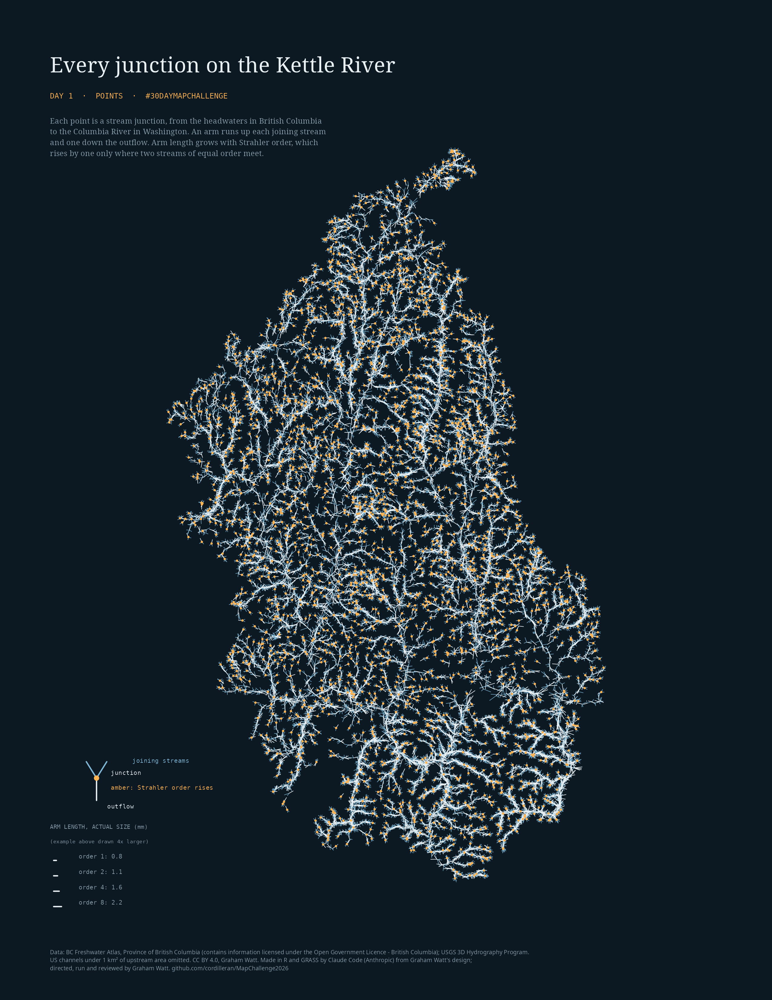

# MapChallenge2026

Code and maps for the 2026 [#30DayMapChallenge](https://30daymapchallenge.com/), by Graham Watt. One map a day in November; work in progress.

| Day | Theme | Map | Status |
|---|---|---|---|
| 1 | Points | Every junction on the Kettle River (British Columbia and Washington) | done |

Each day lives in `day-NN/` (`scripts/`, `out/`). Large data stays outside the repo. The site in `site/` is a calendar of the month, one page per finished day, and a dynamic map for Day 1.

## Day 1: every junction on the Kettle River

Every junction in a river network is a point on a map, inheriting the flow from the main stem and its tributaries. Each of the 12,847 junctions in the Kettle River basin, from the headwaters in British Columbia to the head of the Lake Roosevelt reach on the Columbia River in Washington, is drawn as one small glyph: an arm up each joining stream and one down the outflow. Arm length grows with the stream's size. Two versions use the same junctions:

- **A. Strahler order:** a headwater stream is order 1; order rises by one only where two streams of equal order meet. Arm length is 0.78 mm times the square root of the order on a Letter page.
- **B. Shreve magnitude:** the number of headwater streams upstream. Arm length is 0.8 mm times magnitude to a small power, so tributaries stay visible next to the main river.

An amber dot marks a junction where the Strahler order rises. Nothing else is on the page, so the glyphs draw the basin.

Outputs: `day-01/out/day01_final_strahler.png` and `day01_final_shreve.png` (Letter, 300 dpi); the same as vector PDFs in `site/files/`; the Day 1 page and the dynamic Leaflet map in `site/`.

### Data

| Data | Source | Licence |
|---|---|---|
| BC stream network (watershed group KETL) | BC Freshwater Atlas, BC Data Catalogue | Open Government Licence - British Columbia |
| US stream network | USGS 3D Hydrography Program flowlines | public domain |
| Elevation | a 30 m DEM covering the basin and extended south over the Columbia reach (the author's patched surface built from the Canadian CDEM; any 30 m DEM that covers the region works) | not redistributed |
| Local units used for the basin footprint | BC Watershed Atlas 1:50,000 watersheds (matching only) | Open Government Licence - British Columbia |

Contains information licensed under the Open Government Licence - British Columbia. More in `THIRD_PARTY.md`.

### Method in six lines

1. Reverse the BC lines (the extract is digitized upstream) and join BC and US lines at the border (mutual nearest ends within 1 km).
2. BC keeps its source order. 3DHP has none here, so US order is computed (Strahler); a braid re-join does not raise it. Shreve magnitude sums the inflows.
3. A junction is a node with two or more inflows; 248 braid re-joins (inflows that share an upstream split) are excluded.
4. US headwater branches that never reach 1 km² of upstream area on the DEM are dropped, because raw 3DHP has twice the junction density of the BC data at the same stream length per area (214 against 117 per 100 km²; 120 against 117 after).
5. Arm direction is the first 150 m of each stream line. Arm length is fixed on the page and converted to ground metres.
6. Static maps in R (ggplot2); dynamic map in Leaflet on a canvas layer, arm length in screen pixels, smaller streams revealed as you zoom.

### Reproduce

Needs R 4.6 with the packages in `day-01/requirements-R.txt`, GRASS GIS 8.4, and Quarto 1.9 for the site. The data folder stays outside the repo. Set these environment variables, then run `day-01/run_day01.sh` (it skips steps whose output exists):

| Variable | What |
|---|---|
| `MC26_DATA` | working folder for derived files (created if missing) |
| `MC26_GRASS_LOC` | GRASS location folder (projected, EPSG:3005) that holds the DEM mapset |
| `MC26_DEM` | the DEM as `name@mapset` inside that location |
| `MC26_FWA` | FWA stream network for watershed group KETL (GeoJSON, with `STREAM_ORDER`) |
| `MC26_BC50K` | BC Watershed Atlas 1:50,000 watersheds, Kettle region (GeoPackage) |
| `MC26_3DHP` | USGS 3DHP flowlines for the region (GeoPackage, layer `flowline`) |
| `MC26_MAPSET`, `MC26_TAG`, `MC26_MINAREA` | optional: GRASS mapset name (default `mapchallenge2026`), network file suffix (default `_a1`), pruning threshold in km² (default 1) |

The region in scripts 04, 07, 10 is written for this basin in BC Albers (EPSG:3005): north 612000, south 420000, east 1595000, west 1465000.

| Step | Script | Makes |
|---|---|---|
| 04 | `scripts/04_weighted_accumulation.sh` | flow accumulation, DEM export (GRASS) |
| 07 | `scripts/07_derive_units.sh 5` | streams and local basins at 5 km² (GRASS) |
| 10 | `scripts/10_reach_tables.sh` | reach table (GRASS) |
| 12 | `scripts/12_make_units_a16.R` | local units by the area-chain rule, A = 16 km² (the basin footprint) |
| 20 | `scripts/20_clip_3dhp.R` | 3DHP flowlines inside the basin |
| 21 | `scripts/21_build_graph_3dhp.R` | merged network; run once with `MC26_TAG="" MC26_MINAREA=0` (unthinned), once with the defaults (thinned) |
| 23 | `scripts/23_density_calibration.R` | junction density by side; shows why 1 km² |
| 22 | `scripts/22_shreve.R` | Shreve magnitude on the arms |
| 24 | `scripts/24_final_static.R` | the two static maps (`MC26_VARIANT=strahler` or `shreve`) |
| 25 | `scripts/25_export_leaflet_data.R` | data file for the Leaflet map |
| site | `quarto render site` | the pages |

`day-01/exploration/` holds scripts that were tried and set aside: a first network from NHDPlus V2, a yield-by-width idea (ERA5-Land runoff and biogeoclimatic zones against nine gauges), other rules for local units, and the first draft renders. They are not needed to reproduce the maps; they read the same variables plus `MC26_GAUGE_DB`, `MC26_BEC` and `MC26_ERA5_RO`.

### Limits

- The network ends about 20 km above the Columbia, where 3DHP has no line through Lake Roosevelt.
- The BC and US sources map channels at different sizes. The 1 km² rule evens the junction density, but US stream length per area is still lower (1.2 against 1.7 km per km²).
- Orders from maps of different scale are not directly comparable. Arm directions are schematic.
- The braid test looks at the first two inflows of a node only; 31 of 13,095 junctions have three or more.

## How made

The pipeline and the maps were written by Claude Code (Anthropic) from Graham Watt's design; Graham Watt directed, ran and reviewed the work. The code was reviewed before publication by two AI reviewers (Gemini 4 Argon and Gemini 3.8 Flash through the agy command line), and every finding was checked against the code by hand.

## Licence

Code: MIT (`LICENSE`). Maps, images and the derived data file: CC BY 4.0 (`LICENSE-IMAGES.md`). Third-party data, software and fonts: `THIRD_PARTY.md`. To cite: `CITATION.cff`.
