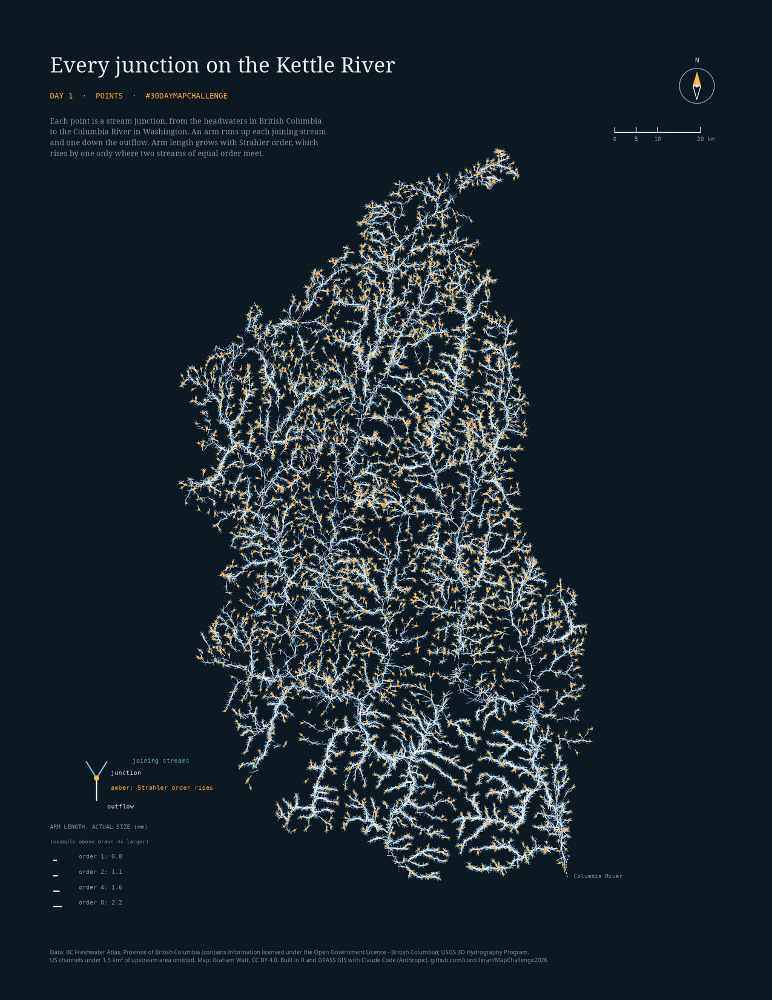

# Day 1 · Points: every junction on the Kettle River

Every junction in a river network is a point on a map, inheriting the flow from the main stem and its tributaries. Each of the 12,914 junctions in the Kettle River basin, from the headwaters in British Columbia to the Columbia River at Lake Roosevelt in Washington, is drawn as one small glyph: an arm up each joining stream and one down the outflow. Arm length grows with the stream's size. Two versions use the same junctions:

- **A. Strahler order:** a headwater stream is order 1; order rises by one only where two streams of equal order meet. Arm length is 0.78 mm times the square root of the order on a Letter page.
- **B. Shreve magnitude:** the number of headwater streams upstream. Arm length is 0.8 mm times magnitude to a small power, so tributaries stay visible next to the main river.

An amber dot marks a junction where the Strahler order rises. The last junction, where the Kettle meets the Columbia, is ringed; the Columbia is drawn dashed because it is far larger than anything else on the page.

Outputs: `out/day01_final_strahler.png` and `day01_final_shreve.png` (Letter, 300 dpi; made by step 24, kept out of git); the web images as WebP in [`site/img/`](../site/img/); the same maps as vector PDFs in [`site/files/`](../site/files/); the Day 1 page and the dynamic Leaflet map on the [site](https://cordilleran.github.io/MapChallenge2026/day-01.html) (stream names in the readout, shaded relief made from the same DEM).

## Data

| Data | Source | Licence |
|---|---|---|
| BC stream network (watershed group KETL) | BC Freshwater Atlas, BC Data Catalogue | Open Government Licence - British Columbia |
| US stream network | USGS 3D Hydrography Program flowlines | public domain |
| Elevation | my previously assembled 30 m DEM: Canadian Digital Elevation Model tiles for BC and USGS 3D Elevation Program (3DEP) 1/3 arc-second tiles for Washington, merged and reprojected (any 30 m DEM that covers the region works) | the DEM is not redistributed; the relief image on the map page is made from it |
| Local units used for the basin footprint | BC Watershed Atlas 1:50,000 watersheds (matching only) | Open Government Licence - British Columbia |

Contains information licensed under the Open Government Licence - British Columbia and the Open Government Licence - Canada. More in [`THIRD_PARTY.md`](../THIRD_PARTY.md).

## Get the data

| Input | Where |
|---|---|
| FWA stream network, watershed group KETL | BC Data Catalogue, "Freshwater Atlas Stream Network" (`WHSE_BASEMAPPING.FWA_STREAM_NETWORKS_SP`), filtered to `WATERSHED_GROUP_CODE = 'KETL'` |
| BC 1:50,000 watersheds | BC Data Catalogue, "Watershed Atlas 1:50,000 watersheds" (`WHSE_FISH.WDIC_WATERSHED_POLY_SVW`), Kettle codes starting `320-` |
| 3DHP flowlines | USGS 3D Hydrography Program downloads (national or work-unit geodatabase), the `flowline` layer clipped to the region |
| 30 m DEM | any 30 m surface over the region, imported to a GRASS location in EPSG:3005 |

[`env.example`](env.example) lists the variables to set.

## Method in six lines

1. Reverse the BC lines (the extract is digitized upstream; its CRS tag also says WGS84 while the coordinates are BC Albers) and join BC and US lines at the border (mutual nearest ends within 1 km). The network ends at the Kettle's mouth on the Columbia (`MC26_MOUTH`).
2. BC keeps its source order. 3DHP has none here, so US order is computed (Strahler); a braid re-join does not raise it. Shreve magnitude sums the inflows.
3. A junction is a node with two or more inflows; 251 braid re-joins (inflows that share an upstream split) are excluded.
4. US headwater branches that never reach 1.5 km² of upstream area on the DEM are dropped, because raw 3DHP has twice the junction density of the BC data (247 against 117 per 100 km²; 123 against 117 after).
5. Arm direction is the first 150 m of each stream line. Arm length is fixed on the page and converted to ground metres.
6. Static maps in R (ggplot2), built in BC Albers and drawn in UTM zone 11N (NAD83) so north is close to page up, with a north arrow to true north and a scale bar from [`shared/R/`](../shared/R/); dynamic map in Leaflet on a canvas layer, arm length in screen pixels, smaller streams revealed as you zoom, over a muted shaded relief made from the DEM (`MC26_RELIEF=dark` gives a dark one).

## Reproduce

Needs R 4.6 with the packages in [`requirements-R.txt`](requirements-R.txt), GRASS GIS 8.4, the Noto Serif, Noto Sans and DejaVu Sans Mono fonts (named in step 24 so the PNG and PDF match), and Quarto 1.9 for the site. The data folder stays outside the repo. Set these environment variables (template: [`env.example`](env.example)), then run [`run_day01.sh`](run_day01.sh) from the repo root (it skips steps whose output exists):

| Variable | What |
|---|---|
| `MC26_DATA` | working folder for derived files (created if missing) |
| `MC26_GRASS_LOC` | GRASS location folder (projected, EPSG:3005) that holds the DEM mapset |
| `MC26_DEM` | the DEM as `name@mapset` inside that location |
| `MC26_FWA` | FWA stream network for watershed group KETL (GeoJSON, with `STREAM_ORDER`) |
| `MC26_BC50K` | BC Watershed Atlas 1:50,000 watersheds, Kettle region (GeoPackage) |
| `MC26_3DHP` | USGS 3DHP flowlines for the region (GeoPackage, layer `flowline`) |
| `MC26_MAPSET`, `MC26_TAG`, `MC26_MINAREA`, `MC26_MOUTH` | optional: GRASS mapset name (default `mapchallenge2026`), network file suffix (default `_a15`), pruning threshold in km² (default 1.5), the Kettle's mouth as lon,lat (default `-118.1089,48.6629`) |

The region in scripts 04, 07, 10 is written for this basin in BC Albers (EPSG:3005): north 612000, south 420000, east 1595000, west 1465000.

| Step | Script | Makes |
|---|---|---|
| 04 | `scripts/04_weighted_accumulation.sh` | flow accumulation, DEM export (GRASS) |
| 07 | `scripts/07_derive_units.sh 5` | streams and local basins at 5 km² (GRASS) |
| 10 | `scripts/10_reach_tables.sh` | reach table (GRASS) |
| 12 | `scripts/12_make_units_a16.R` | local units by the area-chain rule, A = 16 km² (the basin footprint) |
| 20 | `scripts/20_clip_3dhp.R` | 3DHP flowlines inside the basin |
| 21 | `scripts/21_build_graph_3dhp.R` | merged network; run once with `MC26_TAG="" MC26_MINAREA=0` (unthinned), once with the defaults (thinned at 1.5 km²) |
| 23 | `scripts/23_density_calibration.R` | junction density by side; the basis for the threshold |
| 22 | `scripts/22_shreve.R` | Shreve magnitude on the arms |
| 24 | `scripts/24_final_static.R` | the two static maps (`MC26_VARIANT=strahler` or `shreve`) |
| 25 | `scripts/25_export_leaflet_data.R` | data file for the Leaflet map (junctions, stream names, upstream area from the DEM, the mouth) |
| 25a | `scripts/25a_check_upstream_area.R` | a check (writes nothing): why upstream area is shown per junction and not per arm; helpers in `scripts/lib_area.R` |
| 26 | `scripts/26_relief.R` | shaded relief image for the Leaflet map |
| 27 | `scripts/27_site_images.R` | page images, detail crops and the calendar thumbnail |
| site | `Rscript site/calendar.R`, then `quarto render site` (from the repo root) | the calendar from `site/days.yml`, then the pages (GitHub builds and deploys them on each push) |

[`exploration/`](exploration/) holds scripts that were tried and set aside: a first network from NHDPlus V2, a yield-by-width idea (ERA5-Land runoff and biogeoclimatic zones against nine gauges), other rules for local units, and the first draft renders. They are not needed to reproduce the maps; they read the same variables plus `MC26_GAUGE_DB`, `MC26_BEC` and `MC26_ERA5_RO`.

## Limits

- Through Lake Roosevelt the Kettle is a 3DHP waterbody connector, a line drawn through the reservoir, not a surveyed channel.
- The BC and US sources map channels at different sizes. The 1.5 km² rule evens the junction density (123 against 117 per 100 km²), but US stream length per area is then lower (1.2 against 1.7 km per km²).
- Upstream area in the map readout is sampled from the DEM flow accumulation near each junction (largest value within 60 m, never less than upstream). It is approximate, and least reliable for small streams and on Lake Roosevelt.
- Orders from maps of different scale are not directly comparable. Arm directions are schematic.
- The braid test looks at the first two inflows of a node only; 32 of the 13,165 nodes with two or more inflows have three or more.

## How made

I developed the concept and directed Claude Code (Anthropic; Claude Sonnet 5.5 and Claude Opus 5.5) to build it with R (sf, terra, igraph, dplyr, ggplot2, ragg, magick) and GRASS GIS 8.4, with Leaflet and Quarto for the web pages. I reviewed the work iteratively before writing and publishing it with Claude's assistance. Before publication the code was also reviewed by Gemini 4 Argon and Gemini 3.8 Flash (through the agy command line), and each of their findings was checked against the code.
