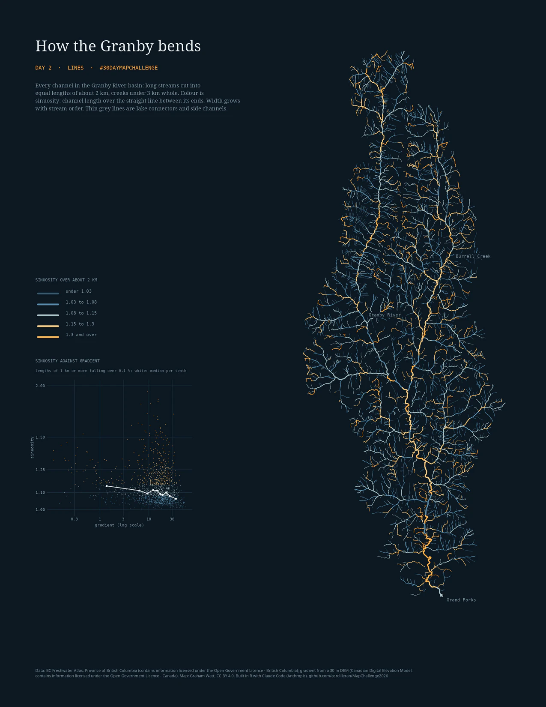

# Day 2 · Lines: how the Granby bends

Every channel in the Granby River basin (British Columbia), 3,556 km of stream, in 3,399 lengths: long streams cut into equal lengths of about 2 km, creeks under 3 km whole (median length 821 m). Colour is sinuosity, channel length over the straight line between a length's ends; width grows with Strahler order. An inset plots sinuosity against gradient from a DEM.

Outputs: `out/day02_final.png` (Letter, 300 dpi; kept out of git) and the same map as a vector PDF in [`site/files/`](../site/files/); the [Day 2 page](https://cordilleran.github.io/MapChallenge2026/day-02.html).

## What it shows

- Sinuosity runs from 1.01 to 1.51 (5th to 99th percentile); 26 % of the channel is 1.15 or more.
- The lower Granby bends most: its last 30 km fall about 0.2 % and have median sinuosity 1.31, against 1.16 for the whole river.
- Flatter lengths bend more, loosely: median sinuosity 1.14 in the flattest tenth of gradient and 1.06 in the steepest (Spearman ρ = −0.22, on the 1,397 lengths of 1 km or more that fall more than 0.1 %). All these numbers are printed by step 01.

## Data

| Data | Source | Licence |
|---|---|---|
| Streams | BC Freshwater Atlas stream network, watershed group KETL; every line whose `FWA_WATERSHED_CODE` starts with the Granby's, `300-571168-245886` | Open Government Licence - British Columbia |
| Elevation (gradient only) | a 30 m DEM in BC Albers; here the Canadian Digital Elevation Model part of the merged DEM from Day 1 | Open Government Licence - Canada |

How to get the FWA extract: see [Day 1's README](../day-01/README.md#get-the-data). Any 30 m DEM covering the basin works.

## Method

1. Select the basin by watershed code. Keep FWA edge types 1000 (single-line main flow) and 1250 (the centreline of double-line rivers, which is how the lower Granby and Burrell Creek are mapped). Lake connectors (1200), side channels and other types are drawn thin and grey and not measured.
2. Join each stream's segments in route-measure order. Segments run upstream, each starting where the last ended (checked: all within 1 m). A run breaks where a non-channel segment interrupts it.
3. Cut each run into `round(length / 2 km)` equal pieces, at least one: pieces from a long run are 1.3 to 3 km, with no stub at the top; a run under 3 km stays whole (67 % of the 3,399 lengths are under 1.3 km). Each piece takes the highest Strahler order among the segments it covers.
4. Sinuosity: piece length over the straight distance between its ends. Gradient: the drop between its ends on the DEM (lowest cell within 30 m of each end) over its length.
5. Measured in BC Albers, the FWA's own projection; drawn in UTM zone 11N (NAD83) with a north arrow to true north and a scale bar from [`shared/R/`](../shared/R/). Map in R (ggplot2): classes 1.03, 1.08, 1.15 and 1.3, from dim river blue to Day 1's amber; line width 0.07 + 0.075 × order (ggplot units).

## Reproduce

Needs R 4.6 with sf, terra, dplyr, ggplot2, ragg and magick (versions in [`../day-01/requirements-R.txt`](../day-01/requirements-R.txt)) and the Noto Serif, Noto Sans and DejaVu Sans Mono fonts. Set the variables in [`env.example`](env.example), then run [`run_day02.sh`](run_day02.sh) from the repo root (about 30 seconds).

| Step | Script | Makes |
|---|---|---|
| 01 | `scripts/01_windows.R` | the 2 km lengths with sinuosity and gradient (`windows.gpkg` in `MC26_DAY02_DATA`) |
| 02 | `scripts/02_map.R` | the Letter map, PNG and PDF |
| 03 | `scripts/03_site_images.R` | page, detail and calendar images (WebP) |

`MC26_BASIN_CODE` picks another basin in the extract by its FWA watershed code (with `MC26_MAIN_STEM`, the GNIS name of its main river); `MC26_WINDOW` changes the length (m). Step 01 runs on any basin in the extract; step 02's title, river labels and town are written for the Granby and need editing for another basin.

## Limits

- Sinuosity depends on the length measured: shorter lengths catch small wiggles, longer ones whole valley bends. Creeks under 1.3 km are measured over their whole length and compare less well with the long rivers.
- Mapped lines simplify the real channel, more so for small creeks.
- Gradient from a 30 m DEM is coarse over short lengths and on flat valley floors.

## How made

I chose the theme and the basin and directed Claude Code (Anthropic; Claude Opus 5.5) to build it in R (sf, terra, dplyr, ggplot2, ragg, magick), with Quarto for the page. I reviewed the work before publishing. The code was reviewed by Gemini 4 Argon and Gemini 3.8 Flash (through the agy command line), and each finding was checked against the code.
