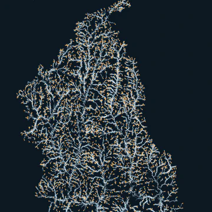

```{=html}
<main class="wrap">
<header><p class="kicker">30 Day Map Challenge · November 2026</p><h1>Every day or so, a map.</h1></header>
<div class="cal" aria-label="November 2026, one tile per day">
<div class="wd" aria-hidden="true">Sun</div>
<div class="wd" aria-hidden="true">Mon</div>
<div class="wd" aria-hidden="true">Tue</div>
<div class="wd" aria-hidden="true">Wed</div>
<div class="wd" aria-hidden="true">Thu</div>
<div class="wd" aria-hidden="true">Fri</div>
<div class="wd" aria-hidden="true">Sat</div>
<div class="tile done flip" data-day="1"><div class="card"><button type="button" class="face front" aria-label="Day 1, Points: open"><span class="n">1</span><span class="ico"><svg xmlns="http://www.w3.org/2000/svg" viewBox="0 0 24 24" fill="none" stroke="currentColor" stroke-width="1.4" stroke-linecap="round" stroke-linejoin="round"><style>.f{fill:currentColor;stroke:none}</style><circle cx="8" cy="15" r="3" class="f"/><circle cx="16.5" cy="8" r="1.8" class="f"/><circle cx="17" cy="17" r="1.2" class="f"/><circle cx="6.5" cy="6.5" r="1" class="f"/></svg></span><span class="t">Points</span></button><a class="face back" href="day-01.html" aria-label="Day 1, Points: go to the map"><span class="n">1</span><span class="t">Points</span></a></div></div> 
<div class="tile planned" data-day="2" aria-label="Day 2, Lines, planned"><span class="face"><span class="n">2</span><span class="ico"><svg xmlns="http://www.w3.org/2000/svg" viewBox="0 0 24 24" fill="none" stroke="currentColor" stroke-width="1.4" stroke-linecap="round" stroke-linejoin="round"><style>.f{fill:currentColor;stroke:none}</style><path d="M4 18 L9 11 L14 14 L20 5"/><circle cx="9" cy="11" r="1.2" class="f"/><circle cx="14" cy="14" r="1.2" class="f"/></svg></span><span class="t">Lines</span></span></div> 
<div class="tile planned" data-day="3" aria-label="Day 3, Polygons, planned"><span class="face"><span class="n">3</span><span class="ico"><svg xmlns="http://www.w3.org/2000/svg" viewBox="0 0 24 24" fill="none" stroke="currentColor" stroke-width="1.4" stroke-linecap="round" stroke-linejoin="round"><style>.f{fill:currentColor;stroke:none}</style><path d="M5 9 L12 4 L19 8 L17 18 L8 19 Z"/></svg></span><span class="t">Polygons</span></span></div> 
<div class="tile planned" data-day="4" aria-label="Day 4, Clusters, planned"><span class="face"><span class="n">4</span><span class="ico"><svg xmlns="http://www.w3.org/2000/svg" viewBox="0 0 24 24" fill="none" stroke="currentColor" stroke-width="1.4" stroke-linecap="round" stroke-linejoin="round"><style>.f{fill:currentColor;stroke:none}</style><circle cx="7" cy="8" r="1.5" class="f"/><circle cx="10" cy="7" r="1.5" class="f"/><circle cx="8.5" cy="10.5" r="1.5" class="f"/><circle cx="6" cy="11.5" r="1.5" class="f"/><circle cx="11.5" cy="10.5" r="1.5" class="f"/><circle cx="9.5" cy="13.5" r="1.5" class="f"/><circle cx="17" cy="16.5" r="1.5" class="f"/><circle cx="19" cy="15" r="1.5" class="f"/><circle cx="18" cy="18.5" r="1.5" class="f"/></svg></span><span class="t">Clusters</span></span></div> 
<div class="tile planned" data-day="5" aria-label="Day 5, Senses: Sight, planned"><span class="face"><span class="n">5</span><span class="ico"><svg xmlns="http://www.w3.org/2000/svg" viewBox="0 0 24 24" fill="none" stroke="currentColor" stroke-width="1.4" stroke-linecap="round" stroke-linejoin="round"><style>.f{fill:currentColor;stroke:none}</style><path d="M2 12 C5 6.5 8.5 5 12 5 C15.5 5 19 6.5 22 12 C19 17.5 15.5 19 12 19 C8.5 19 5 17.5 2 12 Z"/><circle cx="12" cy="12" r="3.2"/></svg></span><span class="t">Senses: Sight</span></span></div> 
<div class="tile planned" data-day="6" aria-label="Day 6, Vintage, planned"><span class="face"><span class="n">6</span><span class="ico"><svg xmlns="http://www.w3.org/2000/svg" viewBox="0 0 24 24" fill="none" stroke="currentColor" stroke-width="1.4" stroke-linecap="round" stroke-linejoin="round"><style>.f{fill:currentColor;stroke:none}</style><circle cx="12" cy="12" r="9"/><path d="M12 5 L14 12 L12 19 L10 12 Z"/><circle cx="12" cy="12" r=".8" class="f"/></svg></span><span class="t">Vintage</span></span></div> 
<div class="tile planned" data-day="7" aria-label="Day 7, 10 minute map, planned"><span class="face"><span class="n">7</span><span class="ico"><svg xmlns="http://www.w3.org/2000/svg" viewBox="0 0 24 24" fill="none" stroke="currentColor" stroke-width="1.4" stroke-linecap="round" stroke-linejoin="round"><style>.f{fill:currentColor;stroke:none}</style><circle cx="12" cy="13.5" r="8"/><path d="M10 2.5 H14 M12 5.5 V2.5"/><path d="M12 13.5 V7.5 A6 6 0 0 1 17.2 10.5 Z" class="f"/></svg></span><span class="t">10 minute map</span></span></div> 
<div class="tile planned" data-day="8" aria-label="Day 8, Utopia, planned"><span class="face"><span class="n">8</span><span class="ico"><svg xmlns="http://www.w3.org/2000/svg" viewBox="0 0 24 24" fill="none" stroke="currentColor" stroke-width="1.4" stroke-linecap="round" stroke-linejoin="round"><style>.f{fill:currentColor;stroke:none}</style><path d="M3 17 H21 M6 20.5 H18 M7 17 A5 5 0 0 1 17 17 M12 6 V3.5 M5.5 9.5 L3.8 7.8 M18.5 9.5 L20.2 7.8"/></svg></span><span class="t">Utopia</span></span></div> 
<div class="tile planned" data-day="9" aria-label="Day 9, Urban-rural, planned"><span class="face"><span class="n">9</span><span class="ico"><svg xmlns="http://www.w3.org/2000/svg" viewBox="0 0 24 24" fill="none" stroke="currentColor" stroke-width="1.4" stroke-linecap="round" stroke-linejoin="round"><style>.f{fill:currentColor;stroke:none}</style><path d="M3 21 H21"/><rect x="3.5" y="9" width="5" height="12"/><rect x="9.5" y="4" width="5" height="17"/><path d="M17 21 L17.5 12 M20 21 L20 13 M14.8 21 L15 15"/></svg></span><span class="t">Urban-rural</span></span></div> 
<div class="tile planned" data-day="10" aria-label="Day 10, Prompting only, planned"><span class="face"><span class="n">10</span><span class="ico"><svg xmlns="http://www.w3.org/2000/svg" viewBox="0 0 24 24" fill="none" stroke="currentColor" stroke-width="1.4" stroke-linecap="round" stroke-linejoin="round"><style>.f{fill:currentColor;stroke:none}</style><rect x="3" y="5.5" width="18" height="13" rx="2"/><path d="M7 9.5 L10 12 L7 14.5 M12.5 15 H17"/></svg></span><span class="t">Prompting only</span></span></div> 
<div class="tile planned" data-day="11" aria-label="Day 11, Senses: Sound, planned"><span class="face"><span class="n">11</span><span class="ico"><svg xmlns="http://www.w3.org/2000/svg" viewBox="0 0 24 24" fill="none" stroke="currentColor" stroke-width="1.4" stroke-linecap="round" stroke-linejoin="round"><style>.f{fill:currentColor;stroke:none}</style><path d="M4 10 H8 L13 6 V18 L8 14 H4 Z"/><path d="M16 9.5 A3.5 3.5 0 0 1 16 14.5 M18.5 7 A7 7 0 0 1 18.5 17"/></svg></span><span class="t">Senses: Sound</span></span></div> 
<div class="tile planned" data-day="12" aria-label="Day 12, Power, planned"><span class="face"><span class="n">12</span><span class="ico"><svg xmlns="http://www.w3.org/2000/svg" viewBox="0 0 24 24" fill="none" stroke="currentColor" stroke-width="1.4" stroke-linecap="round" stroke-linejoin="round"><style>.f{fill:currentColor;stroke:none}</style><path d="M13 2.5 L5 13.5 H11 L10 21.5 L19 10 H13 Z"/></svg></span><span class="t">Power</span></span></div> 
<div class="tile planned" data-day="13" aria-label="Day 13, Interactions, planned"><span class="face"><span class="n">13</span><span class="ico"><svg xmlns="http://www.w3.org/2000/svg" viewBox="0 0 24 24" fill="none" stroke="currentColor" stroke-width="1.4" stroke-linecap="round" stroke-linejoin="round"><style>.f{fill:currentColor;stroke:none}</style><path d="M5 4 V17 L8.5 13.5 L11.5 20 L13.5 19 L10.5 12.5 L15 12.5 Z"/><path d="M16 3.5 A4.5 4.5 0 0 1 20.5 8 M16 .5 A7.5 7.5 0 0 1 23.5 8"/></svg></span><span class="t">Interactions</span></span></div> 
<div class="tile planned" data-day="14" aria-label="Day 14, Borgesian map, planned"><span class="face"><span class="n">14</span><span class="ico"><svg xmlns="http://www.w3.org/2000/svg" viewBox="0 0 24 24" fill="none" stroke="currentColor" stroke-width="1.4" stroke-linecap="round" stroke-linejoin="round"><style>.f{fill:currentColor;stroke:none}</style><rect x="3" y="3" width="18" height="18"/><rect x="7" y="7" width="10" height="10"/><rect x="10" y="10" width="4" height="4"/><rect x="11.6" y="11.6" width=".8" height=".8" class="f"/></svg></span><span class="t">Borgesian map</span></span></div> 
<div class="tile planned" data-day="15" aria-label="Day 15, Inside out, planned"><span class="face"><span class="n">15</span><span class="ico"><svg xmlns="http://www.w3.org/2000/svg" viewBox="0 0 24 24" fill="none" stroke="currentColor" stroke-width="1.4" stroke-linecap="round" stroke-linejoin="round"><style>.f{fill:currentColor;stroke:none}</style><circle cx="12" cy="12" r="3.6"/><path d="M12 7 V2.5 M10 4.5 L12 2.5 L14 4.5 M12 17 V21.5 M10 19.5 L12 21.5 L14 19.5 M17 12 H21.5 M19.5 10 L21.5 12 L19.5 14 M7 12 H2.5 M4.5 10 L2.5 12 L4.5 14"/></svg></span><span class="t">Inside out</span></span></div> 
<div class="tile planned" data-day="16" aria-label="Day 16, Collaborative map, planned"><span class="face"><span class="n">16</span><span class="ico"><svg xmlns="http://www.w3.org/2000/svg" viewBox="0 0 24 24" fill="none" stroke="currentColor" stroke-width="1.4" stroke-linecap="round" stroke-linejoin="round"><style>.f{fill:currentColor;stroke:none}</style><circle cx="9" cy="12" r="6"/><circle cx="15" cy="12" r="6"/></svg></span><span class="t">Collaborative map</span></span></div> 
<div class="tile planned" data-day="17" aria-label="Day 17, Light &amp; dark, planned"><span class="face"><span class="n">17</span><span class="ico"><svg xmlns="http://www.w3.org/2000/svg" viewBox="0 0 24 24" fill="none" stroke="currentColor" stroke-width="1.4" stroke-linecap="round" stroke-linejoin="round"><style>.f{fill:currentColor;stroke:none}</style><circle cx="12" cy="12" r="8.5"/><path d="M12 3.5 A8.5 8.5 0 0 0 12 20.5 Z" class="f"/></svg></span><span class="t">Light &amp; dark</span></span></div> 
<div class="tile planned" data-day="18" aria-label="Day 18, NULL, planned"><span class="face"><span class="n">18</span><span class="ico"><svg xmlns="http://www.w3.org/2000/svg" viewBox="0 0 24 24" fill="none" stroke="currentColor" stroke-width="1.4" stroke-linecap="round" stroke-linejoin="round"><style>.f{fill:currentColor;stroke:none}</style><circle cx="12" cy="12" r="8"/><path d="M6.5 17.5 L17.5 6.5"/></svg></span><span class="t">NULL</span></span></div> 
<div class="tile planned" data-day="19" aria-label="Day 19, Senses: Smell, planned"><span class="face"><span class="n">19</span><span class="ico"><svg xmlns="http://www.w3.org/2000/svg" viewBox="0 0 24 24" fill="none" stroke="currentColor" stroke-width="1.4" stroke-linecap="round" stroke-linejoin="round"><style>.f{fill:currentColor;stroke:none}</style><path d="M6 20 C4 17 8 15 6 12 C4 9 8 7 6 4 M12 20 C10 17 14 15 12 12 C10 9 14 7 12 4 M18 20 C16 17 20 15 18 12 C16 9 20 7 18 4"/></svg></span><span class="t">Senses: Smell</span></span></div> 
<div class="tile planned" data-day="20" aria-label="Day 20, Hexagons, planned"><span class="face"><span class="n">20</span><span class="ico"><svg xmlns="http://www.w3.org/2000/svg" viewBox="0 0 24 24" fill="none" stroke="currentColor" stroke-width="1.4" stroke-linecap="round" stroke-linejoin="round"><style>.f{fill:currentColor;stroke:none}</style><path d="M8.00 3.90 L11.98 6.20 L11.98 10.80 L8.00 13.10 L4.02 10.80 L4.02 6.20 Z"/><path d="M16.00 3.90 L19.98 6.20 L19.98 10.80 L16.00 13.10 L12.02 10.80 L12.02 6.20 Z"/><path d="M12.00 10.80 L15.98 13.10 L15.98 17.70 L12.00 20.00 L8.02 17.70 L8.02 13.10 Z"/></svg></span><span class="t">Hexagons</span></span></div> 
<div class="tile planned" data-day="21" aria-label="Day 21, OpenStreetMap, planned"><span class="face"><span class="n">21</span><span class="ico"><svg xmlns="http://www.w3.org/2000/svg" viewBox="0 0 24 24" fill="none" stroke="currentColor" stroke-width="1.4" stroke-linecap="round" stroke-linejoin="round"><style>.f{fill:currentColor;stroke:none}</style><circle cx="10" cy="10" r="6.5"/><path d="M14.7 14.7 L20.5 20.5 M6.5 12.5 L9.5 8 L13 10.5"/></svg></span><span class="t">OpenStreetMap</span></span></div> 
<div class="tile planned" data-day="22" aria-label="Day 22, Projections, planned"><span class="face"><span class="n">22</span><span class="ico"><svg xmlns="http://www.w3.org/2000/svg" viewBox="0 0 24 24" fill="none" stroke="currentColor" stroke-width="1.4" stroke-linecap="round" stroke-linejoin="round"><style>.f{fill:currentColor;stroke:none}</style><circle cx="12" cy="12" r="8.5"/><ellipse cx="12" cy="12" rx="4" ry="8.5"/><path d="M3.5 12 H20.5 M5 7.5 H19 M5 16.5 H19"/></svg></span><span class="t">Projections</span></span></div> 
<div class="tile planned" data-day="23" aria-label="Day 23, Senses: Taste, planned"><span class="face"><span class="n">23</span><span class="ico"><svg xmlns="http://www.w3.org/2000/svg" viewBox="0 0 24 24" fill="none" stroke="currentColor" stroke-width="1.4" stroke-linecap="round" stroke-linejoin="round"><style>.f{fill:currentColor;stroke:none}</style><path d="M6 3 V9 M9 3 V9 M12 3 V9 M6 9 Q6 12 9 12 Q12 12 12 9 M9 12 V21"/></svg></span><span class="t">Senses: Taste</span></span></div> 
<div class="tile planned" data-day="24" aria-label="Day 24, Network, planned"><span class="face"><span class="n">24</span><span class="ico"><svg xmlns="http://www.w3.org/2000/svg" viewBox="0 0 24 24" fill="none" stroke="currentColor" stroke-width="1.4" stroke-linecap="round" stroke-linejoin="round"><style>.f{fill:currentColor;stroke:none}</style><path d="M6 6 L12 12 L18 6 M12 12 L6 18 M12 12 L18 18 M6 6 L6 18"/><circle cx="6" cy="6" r="1.8" class="f"/><circle cx="18" cy="6" r="1.8" class="f"/><circle cx="12" cy="12" r="1.8" class="f"/><circle cx="6" cy="18" r="1.8" class="f"/><circle cx="18" cy="18" r="1.8" class="f"/></svg></span><span class="t">Network</span></span></div> 
<div class="tile planned" data-day="25" aria-label="Day 25, Is this a map?, planned"><span class="face"><span class="n">25</span><span class="ico"><svg xmlns="http://www.w3.org/2000/svg" viewBox="0 0 24 24" fill="none" stroke="currentColor" stroke-width="1.4" stroke-linecap="round" stroke-linejoin="round"><style>.f{fill:currentColor;stroke:none}</style><path d="M3 6 L9 4 L15 6 L21 4 V18 L15 20 L9 18 L3 20 Z"/><path d="M10.6 10 A1.6 1.6 0 1 1 13.2 11.2 C12.5 11.7 12 12.1 12 13"/><circle cx="12" cy="15.4" r=".5" class="f"/></svg></span><span class="t">Is this a map?</span></span></div> 
<div class="tile planned" data-day="26" aria-label="Day 26, Water, planned"><span class="face"><span class="n">26</span><span class="ico"><svg xmlns="http://www.w3.org/2000/svg" viewBox="0 0 24 24" fill="none" stroke="currentColor" stroke-width="1.4" stroke-linecap="round" stroke-linejoin="round"><style>.f{fill:currentColor;stroke:none}</style><path d="M12 3 C12 3 5.5 10.5 5.5 14.5 A6.5 6.5 0 0 0 18.5 14.5 C18.5 10.5 12 3 12 3 Z"/></svg></span><span class="t">Water</span></span></div> 
<div class="tile planned" data-day="27" aria-label="Day 27, New tool, planned"><span class="face"><span class="n">27</span><span class="ico"><svg xmlns="http://www.w3.org/2000/svg" viewBox="0 0 24 24" fill="none" stroke="currentColor" stroke-width="1.4" stroke-linecap="round" stroke-linejoin="round"><style>.f{fill:currentColor;stroke:none}</style><path d="M12 3 C12.8 8.5 15.5 11.2 21 12 C15.5 12.8 12.8 15.5 12 21 C11.2 15.5 8.5 12.8 3 12 C8.5 11.2 11.2 8.5 12 3 Z"/></svg></span><span class="t">New tool</span></span></div> 
<div class="tile planned" data-day="28" aria-label="Day 28, Senses: Feeling, planned"><span class="face"><span class="n">28</span><span class="ico"><svg xmlns="http://www.w3.org/2000/svg" viewBox="0 0 24 24" fill="none" stroke="currentColor" stroke-width="1.4" stroke-linecap="round" stroke-linejoin="round"><style>.f{fill:currentColor;stroke:none}</style><circle cx="12" cy="12" r="1.6" class="f"/><path d="M8.5 8.5 A5 5 0 0 0 8.5 15.5 M15.5 8.5 A5 5 0 0 1 15.5 15.5 M5.5 5.5 A9 9 0 0 0 5.5 18.5 M18.5 5.5 A9 9 0 0 1 18.5 18.5"/></svg></span><span class="t">Senses: Feeling</span></span></div> 
<div class="tile planned" data-day="29" aria-label="Day 29, Raster, planned"><span class="face"><span class="n">29</span><span class="ico"><svg xmlns="http://www.w3.org/2000/svg" viewBox="0 0 24 24" fill="none" stroke="currentColor" stroke-width="1.4" stroke-linecap="round" stroke-linejoin="round"><style>.f{fill:currentColor;stroke:none}</style><rect x="4" y="4" width="16" height="16"/><path d="M8 4 V20 M12 4 V20 M16 4 V20 M4 8 H20 M4 12 H20 M4 16 H20"/><rect x="4" y="8" width="4" height="4" class="f"/><rect x="8" y="8" width="4" height="4" class="f"/><rect x="8" y="12" width="4" height="4" class="f"/><rect x="12" y="4" width="4" height="4" class="f"/><rect x="12" y="12" width="4" height="4" class="f"/><rect x="16" y="16" width="4" height="4" class="f"/><rect x="4" y="16" width="4" height="4" class="f"/></svg></span><span class="t">Raster</span></span></div> 
<div class="tile planned" data-day="30" aria-label="Day 30, Pen &amp; paper, planned"><span class="face"><span class="n">30</span><span class="ico"><svg xmlns="http://www.w3.org/2000/svg" viewBox="0 0 24 24" fill="none" stroke="currentColor" stroke-width="1.4" stroke-linecap="round" stroke-linejoin="round"><style>.f{fill:currentColor;stroke:none}</style><path d="M4 20 L5 15.5 L16 4.5 L19.5 8 L8.5 19 Z M14 6.5 L17.5 10 M11 21 H20"/></svg></span><span class="t">Pen &amp; paper</span></span></div> 
</div>
<footer>Themes from the <a href="https://30daymapchallenge.com/">30 Day Map Challenge</a>. Code and maps: <a href="https://github.com/cordilleran/MapChallenge2026">github.com/cordilleran/MapChallenge2026</a>. Each map says how it was made, including the AI tools used, and credits its data.</footer>
<script>(function(){var cal=document.querySelector(".cal");cal.classList.add("js");var t=new Date(),y=t.getFullYear(),m=t.getMonth(),now=(y>2026||(y===2026&&m>10))?32:(y===2026&&m===10?t.getDate():0);var e=document.querySelector('.tile[data-day="'+now+'"]');if(e){e.classList.add("today");e.setAttribute("aria-current","date");}document.querySelectorAll(".tile:not(.done)").forEach(function(x){if(+x.dataset.day<now)x.classList.add("past");});var seen=[];try{seen=JSON.parse(localStorage.getItem("mc26-open")||"[]");}catch(x){}document.querySelectorAll(".flip").forEach(function(f){var d=f.dataset.day,b=f.querySelector(".front"),a=f.querySelector(".back");function set(o){f.classList.toggle("open",o);b.tabIndex=o?-1:0;a.tabIndex=o?0:-1;b.setAttribute("aria-hidden",o);a.setAttribute("aria-hidden",!o);}set(seen.indexOf(d)>=0);b.addEventListener("click",function(){set(true);a.focus({preventScroll:true});if(seen.indexOf(d)<0){seen.push(d);try{localStorage.setItem("mc26-open",JSON.stringify(seen));}catch(x){}}});});})();</script>
</main>
```
