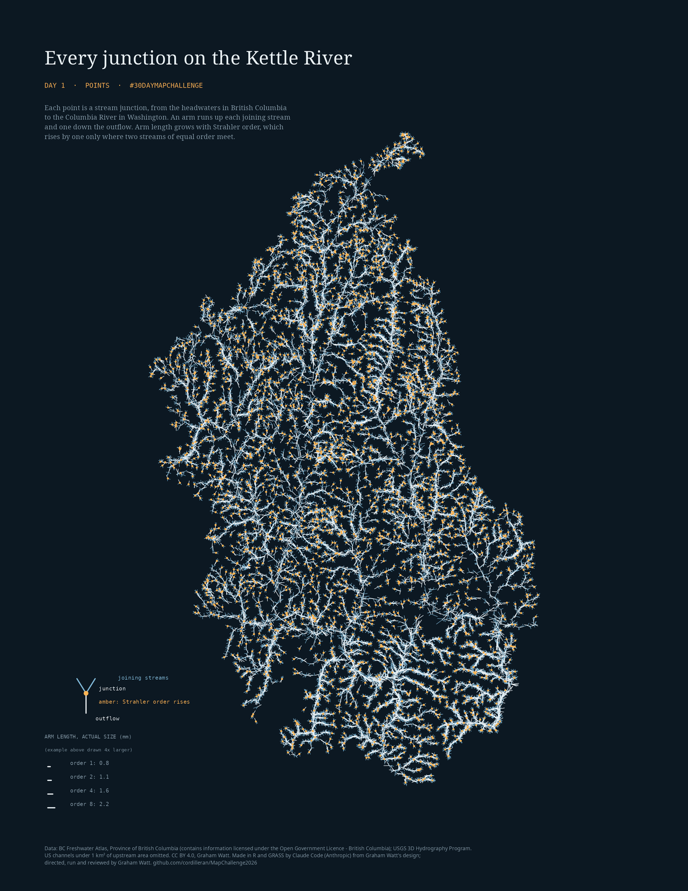
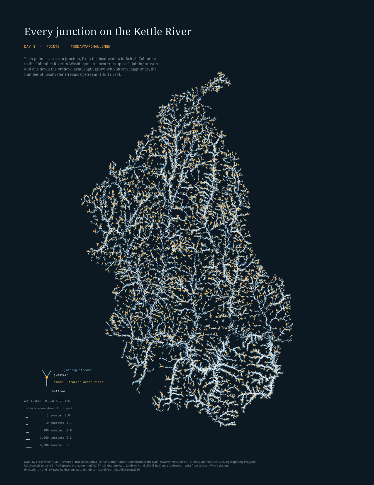
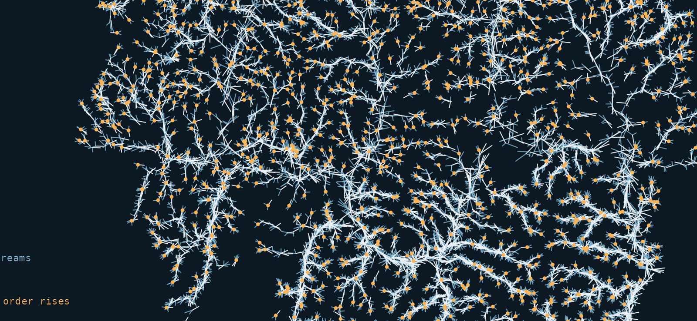
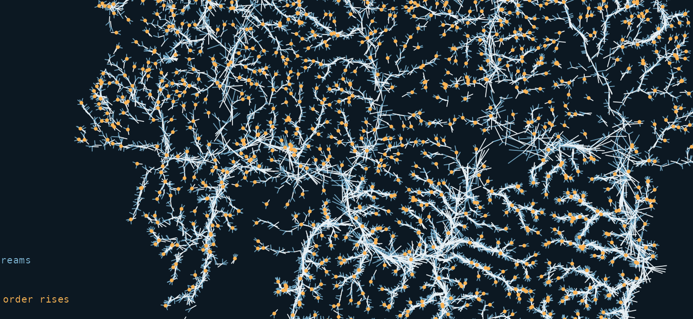
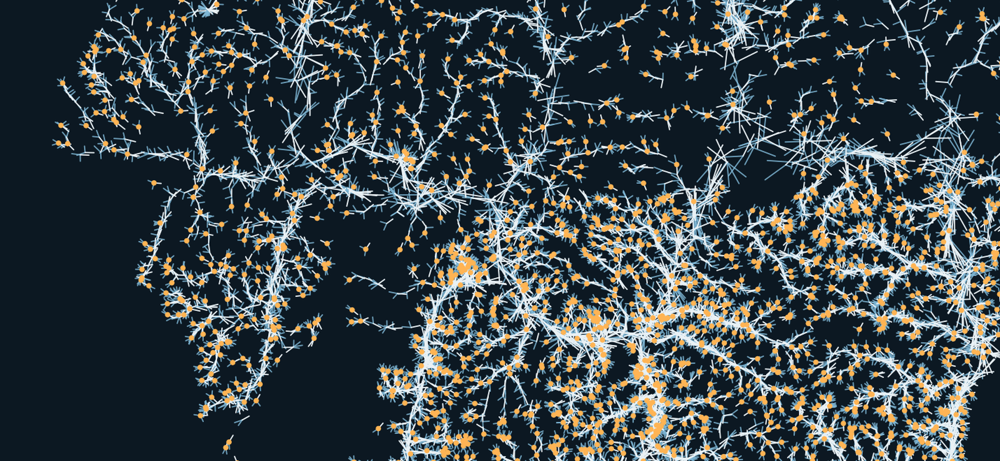

::: {.wrap .day}

<nav class="crumb"><a href="index.html">30 Day Map Challenge 2026</a> / Day 1</nav>

<header>

Day 1 · Points · 1 November 2026

<h1>Every junction on the Kettle River</h1>

Every junction in a river network is a point on a map, inheriting the flow from the main stem and its tributaries. Here each one of 12,847 junctions in the Kettle River basin, from the headwaters in British Columbia to the Columbia River in Washington, is drawn as one small glyph. Nothing else is on the page, so the glyphs draw the basin.

<a class="cta" href="day-01-map.html">Open the dynamic map</a> (zoom, hover, Strahler or Shreve)

</header>

## The two maps, same junctions

<figure><figcaption><b>A. Strahler order.</b> Arm length is the square root of the stream's order (1 to 8). <a href="files/day01_final_strahler.pdf">Letter PDF</a></figcaption></figure>
<figure><figcaption><b>B. Shreve magnitude.</b> Arm length is magnitude to the power 0.147 (1 to 12,285 headwater streams). <a href="files/day01_final_shreve.pdf">Letter PDF</a></figcaption></figure>

## Reading one glyph

<svg viewBox="0 0 340 230" role="img" aria-label="One junction glyph: two upstream arms and one downstream arm">
  
  <line class="a u" x1="140" y1="120" x2="88" y2="48"/><line class="a u" x1="140" y1="120" x2="206" y2="66"/><line class="a d" x1="140" y1="120" x2="140" y2="196"/>
  <circle cx="140" cy="120" r="5" fill="var(--amber)"/>
  <text class="t" x="20" y="38">inflow, order 3</text><text class="t" x="196" y="52">inflow, order 3</text>
  <text class="t" x="150" y="206">outflow, order 4</text><text class="t" x="154" y="116">junction</text>
</svg>
<ul>
<li><b>One point per junction.</b> The glyph sits on the junction.</li>
<li><b>One arm up each joining stream</b> (blue), pointing the way the stream comes from, and <b>one arm down the outflow</b> (pale).</li>
<li><b>Arm length</b> grows with the stream's size, on a scale that keeps small tributaries visible next to the main river (table below).</li>
<li><b>Amber dot:</b> the outflow is a higher order than either inflow. Channels that split and re-join are not counted as junctions.</li>
</ul>

<table><caption>A. Strahler order (square root)</caption><thead><tr><th>Order</th><th>1</th><th>2</th><th>3</th><th>5</th><th>8</th></tr></thead><tbody><tr><th>Arm, mm on Letter</th><td>0.8</td><td>1.1</td><td>1.4</td><td>1.7</td><td>2.2</td></tr></tbody></table>
<table><caption>B. Shreve magnitude (power 0.147)</caption><thead><tr><th>Sources</th><th>1</th><th>10</th><th>100</th><th>1,000</th><th>10,000</th></tr></thead><tbody><tr><th>Arm, mm on Letter</th><td>0.8</td><td>1.1</td><td>1.6</td><td>2.2</td><td>3.1</td></tr></tbody></table>

<b>Strahler order</b> ranks streams: a headwater stream is order 1, order rises by one only where two streams of equal order meet, and otherwise the stream below keeps the higher order. <b>Shreve magnitude</b> counts: every headwater stream upstream adds one. A river can pass many small tributaries and stay order 6 while its magnitude climbs into the thousands.

## Matching the two sides

<table><caption>Junctions per 100 km², braids excluded</caption><thead><tr><th></th><th>BC (FWA)</th><th>US (3DHP)</th></tr></thead><tbody><tr><th>Raw</th><td>117</td><td>214</td></tr><tr><th>US channels start at 1 km² upstream</th><td>117</td><td>120</td></tr></tbody></table>

The two sources draw the same length of stream per area (1.7 and 1.8 km per km²), but 3DHP breaks it into twice as many junctions and starts channels at about half the size (median headwater 0.5 km² against 1.05 km²). One rule on the same DEM, applied to the US side only, brings them level. The pruned lines are headwater branches only; the main chain is never cut.

## Detail at full resolution: the border and the lower Kettle

<figure class="wide"><figcaption>A. Strahler order.</figcaption></figure>
<figure class="wide"><figcaption>B. Shreve magnitude. Main stems stand out more; headwater stubs are the same length as in A.</figcaption></figure>
<figure class="wide"><figcaption>B before thinning. Same area, US reach as it comes from 3DHP: the dense amber cloud south of the border is the difference.</figcaption></figure>

## Data, method and limits

**Data.** BC streams: BC Freshwater Atlas, watershed group KETL (Open Government Licence - British Columbia). US streams: USGS 3D Hydrography Program flowlines (public domain). Elevation: Graham Watt's patched 30 m DEM (built from the Canadian CDEM and a US extension), used to check line direction, to measure the upstream area behind each US channel for the 1 km² rule, and to cut the basin into local units.

**Method.** FWA lines are reversed (the extract runs uphill) and joined to 3DHP lines at 41 border bridges. FWA keeps its source order; 3DHP has none, so US order is computed. Shreve magnitude is the sum of inflows. 248 braid re-joins are not counted as junctions. US channels that never reach 1 km² of upstream area (DEM) are pruned, as whole branches only.

**Limits.** The network ends about 20 km above the Columbia, where 3DHP has no line through Lake Roosevelt. The two sources differ in how small a channel they map; the 1 km² rule evens the junction density, but the US reach still has shorter total stream length (1.2 against 1.7 km per km²). Arm directions are schematic. Orders from different map scales are not directly comparable.

**How made.** Pipeline written by Claude Code (Anthropic, Sonnet 5.5) from Graham Watt's design; Graham Watt directed, ran and reviewed it. R (sf, terra, igraph, ggplot2) and GRASS 8.4. Code: [github.com/cordilleran/MapChallenge2026](https://github.com/cordilleran/MapChallenge2026).

<footer>#30DayMapChallenge · Day 1 Points. Contains information licensed under the Open Government Licence - British Columbia. Code MIT, maps CC BY 4.0; see the repository.</footer>

:::
