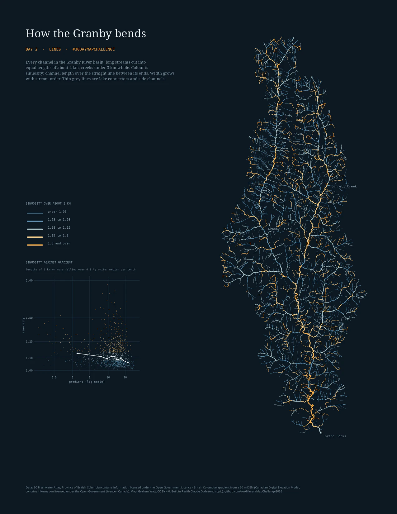
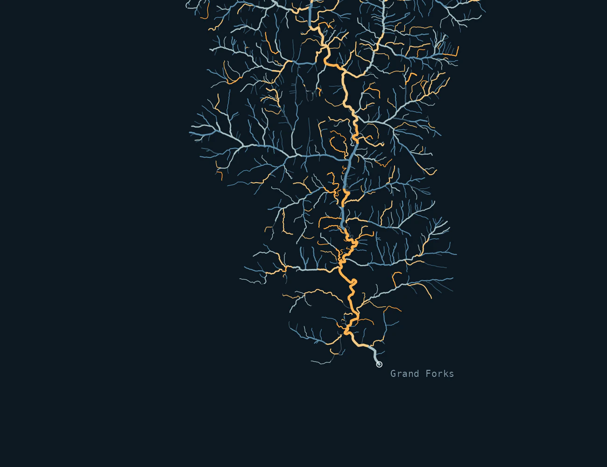

::: {.wrap .day}

<nav class="crumb"><a href="index.html">30 Day Map Challenge 2026</a> / Day 2</nav>

<header>

Day 2 · Lines · 2 November 2026

<h1>How the Granby bends</h1>

Every channel in the Granby River basin, 3,556 km of stream, in 3,399 lengths coloured by how much each one bends.

</header>

<figure class="wide"><figcaption>Width grows with Strahler order. <a href="files/day02_final.pdf">Letter PDF</a></figcaption></figure>

## Reading the colour

**Sinuosity** is channel length over the straight line between the ends: 1.0 is a ruler, 1.3 means the stream travels 30 % farther than the crow flies. Long streams are cut into equal lengths of about 2 km (1.3 to 3 km); a creek under 3 km is one length, so most lengths are short (median 821 m).

**Dim blue** lengths run nearly straight (under 1.03), the usual state of a steep mountain creek. **Amber** lengths bend (1.15 and over, 26 % of the channel). The brightest run is the lower Granby: its last 30 km fall about 0.2 % and bend 1.31 on the median, against 1.16 for the whole river.

**Against gradient.** The inset plots each length of 1 km or more that falls more than 0.1 % (1,397 lengths). The median sinuosity falls from 1.14 in the flattest tenth (about 1.4 % slope) to 1.06 in the steepest (about 36 %): flatter channels bend more, as rivers on their own floodplain do. The link is loose (Spearman ρ = −0.22), because a mountain creek can wind around boulders and a valley-floor channel can be held straight by its valley walls or by people.

## Detail at full resolution: the lower Granby

<figure class="wide"><figcaption>The meanders above Grand Forks, with a straighter canyon reach in the middle.</figcaption></figure>

## Data, method and limits

**Data.** Streams: BC Freshwater Atlas, watershed group KETL, every line whose watershed code starts with the Granby's (Open Government Licence - British Columbia). Elevation for gradient: my previously assembled 30 m DEM, here the Canadian Digital Elevation Model (Open Government Licence - Canada).

**Method.** Each stream's segments are joined in order along the stream and cut into equal lengths of about 2 km, so no short stub is left at the top. Each length takes the highest Strahler order among the segments it covers, so rivers widen downstream. Lake connectors and side channels are drawn thin and grey and not measured. Gradient is the drop between a length's ends on the DEM (lowest cell within 30 m of each end) over its channel length.

**Limits.** Sinuosity depends on the length measured: shorter lengths catch small wiggles, longer ones whole valley bends. Short creeks are measured over less than 1.3 km, so their colours are less comparable with the long rivers'. Mapped lines simplify the real channel, more so for small creeks. Gradient from a 30 m DEM is coarse over short lengths and on the valley floor.

**How made.** I chose the theme and the basin and directed Claude Code (Anthropic; Claude Opus 5.5) to build it in R (sf, terra, dplyr, ggplot2, ragg, magick), with Quarto for this page. I reviewed the work before publishing. The code was reviewed by Gemini 4 Argon and Gemini 3.8 Flash, and each finding was checked against the code.

<footer>#30DayMapChallenge · Day 2 Lines. Contains information licensed under the Open Government Licence - British Columbia and the Open Government Licence - Canada. Code MIT, maps CC BY 4.0; see the repository.</footer>

:::
