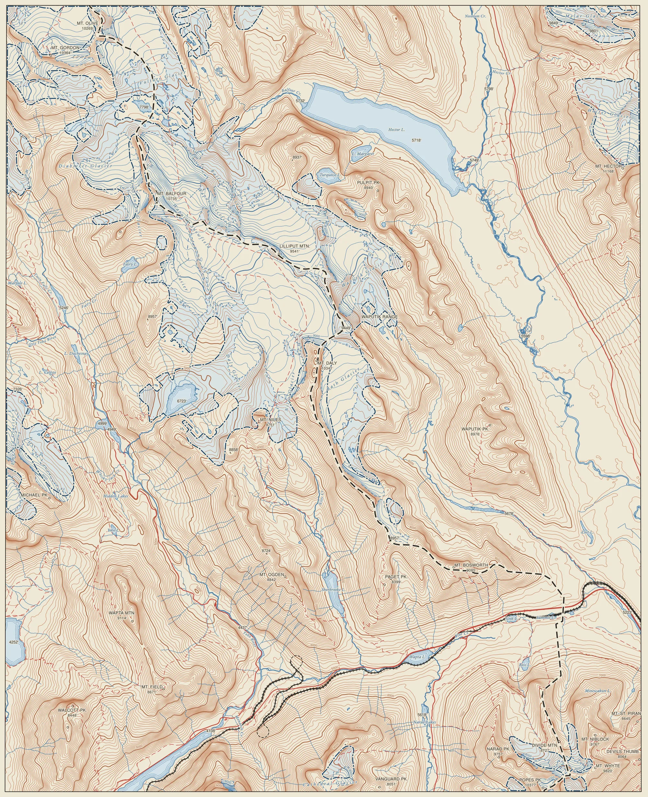
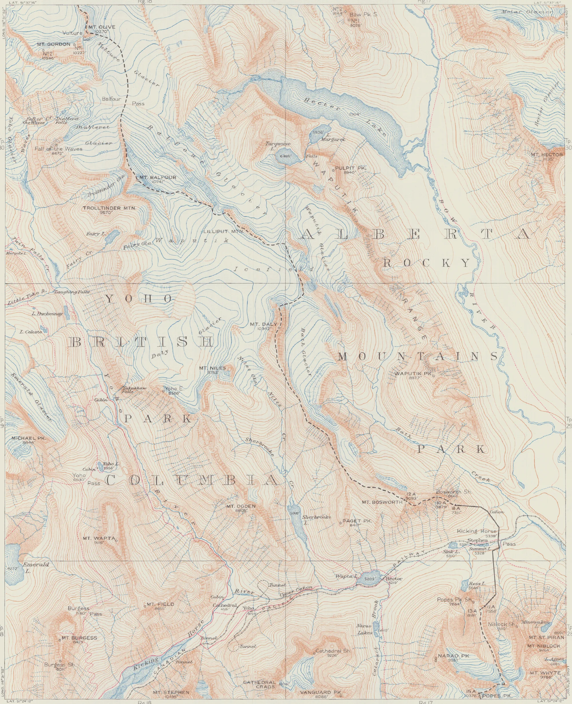
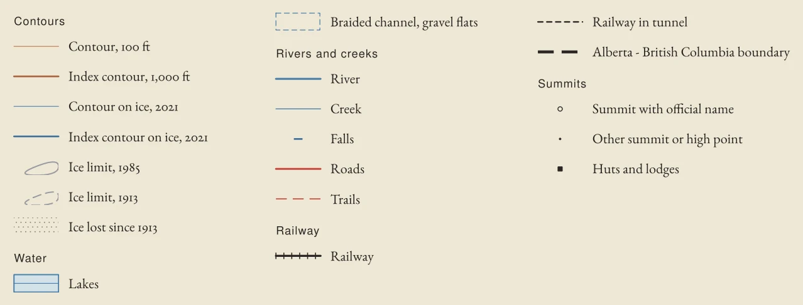
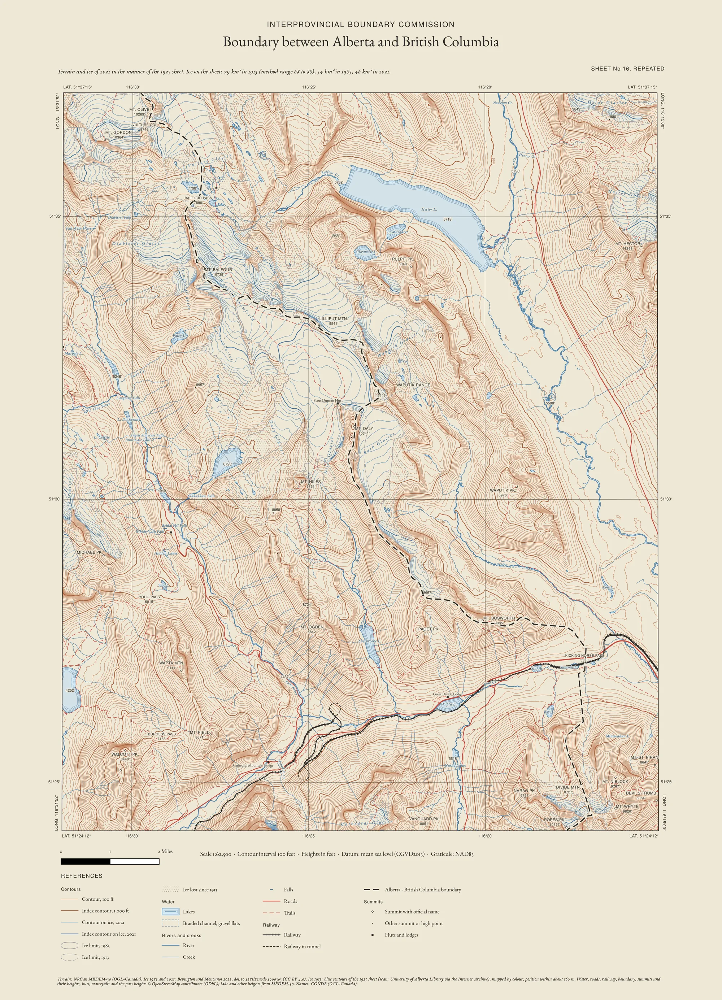

::: {.wrap .day}

<nav class="crumb"><a href="index.html">30 Day Map Challenge 2026</a> <span>/</span> Day 6</nav>

<header>
<p class="kicker">Day 6 · Vintage · 6 November 2026</p>
<h1>Sheet No. 16, repeated</h1>
<p class="sub">The Interprovincial Boundary Commission's 1925 sheet of Kicking Horse Pass, the Waputik Icefield and the Yoho Valley, drawn again from 2021 terrain and ice in the sheet's own manner. Glaciers there have no fill and no edge line: contours turn from brown to blue where they cross ice. Grey lines are where the ice reached in 1985 and when the sheet was surveyed.</p>
</header>

```{=html}
<link rel="stylesheet" href="css/day06.css?v=20261113a">
<div class="d6-tools">
  <div class="seg small" role="group" aria-label="Units of the repeat"><button type="button" data-units="ft" aria-pressed="true">Feet, as in 1925</button><button type="button" data-units="m" aria-pressed="false">Metres</button></div>
  <div class="seg small" role="group" aria-label="Colours of the 1925 sheet"><button type="button" data-scan="raw" aria-pressed="true">As scanned</button><button type="button" data-scan="matched" aria-pressed="false">In the repeat's inks</button></div>
</div>
<label class="rline small">Drag across the map, or use this control: <input id="d6-range" class="d6-range" type="range" min="0" max="100" step="0.5" value="50" aria-label="Divider between the 1925 sheet and the 2021 repeat, percent from the left"></label>
<figure class="d6-map">
<div id="d6-compare" aria-label="The 1925 sheet on the left of the divider, the 2021 repeat on the right">
  
  
  <div id="d6-bar"></div>
  <span class="tag l">1925 sheet</span><span class="tag r">2021</span>
</div>

<figcaption>Left of the divider, the 1925 sheet as printed; right, the same ground in 2021, drawn the same way. Where the contours are blue, there was ice in 2021. The solid grey line is the edge of the ice in 1985, from satellite images. The dashed grey line is the edge in 1913, read from the sheet's blue contours, so it is less certain (within about 160 m). The grey dots cover ground that was ice in 1913 and was bare in 2021. Their inner edge is the 2021 ice margin, which is not drawn as a line, as on the 1925 sheet.</figcaption>
</figure>
<script defer src="https://cdnjs.cloudflare.com/ajax/libs/openseadragon/5.0.1/openseadragon.min.js"></script>
<script defer src="js/day06.js?v=20261113a"></script>
```

<figure class="wide"><div id="d6-sheet-viewer" class="d6-deep" role="img" aria-label="The full repeat sheet with title, map, scale, references and sources, zoomable, with a small overview of the whole sheet"></div><figcaption>The full repeat, 1:62,500, drawn at 600 dpi like the scan below. Zoom with the + and − buttons, a double click or a pinch; drag to move. The units buttons at the top of the page switch it between feet and metres.</figcaption></figure>

<figure class="wide"><div id="d6-scan-viewer" class="d6-deep" role="img" aria-label="The 1925 sheet as scanned at 600 ppi, zoomable, with a small overview of the whole sheet"></div><figcaption>The 1925 sheet itself, the 600 ppi master scan with its margins. Same controls; the small sheet in the corner shows where you are. The original files are at the <a href="https://archive.org/details/AB-BC-sheet16">Internet Archive</a>.</figcaption></figure>

<details class="d6-fold">
<summary><h2>What changed</h2></summary>

<div class="cols">
<div>

**Ice inside the sheet's frame:** about **79 km²** when surveyed in 1913 (the sheet was revised in 1925), 54 km² in 1985 and 46 km² in 2021. That is a loss of about 41 %, or 31 to 47 % across the method's range. Most of it came before the first satellite outline in 1985.

**Where to look.** In 1913 the Balfour Glacier ended about 2.5 km above Hector Lake; by 2021 its nearest ice was 3.3 km away. On the 1925 sheet, the flat between, where Balfour Creek braids into the lake, carries a blue stipple its legend does not list. It reads as gravel flats and delta, as on the Yoho River below the Yoho Glacier. Takakkaw Lake fills ground the Daly Glacier covered in 1913. The Hector and Molar glaciers sit well inside their 1913 lines. The sheet also misses ice: on the north face of Popes Peak and beside The Preacher, the 1985 ice lies where it draws rock.

</div>
<div>

**Reading the repeat.** Brown contours are rock and soil, blue contours are ice in 2021: every 100 feet, heavier every 1,000 (metric: every 25 m, heavier every 250 m). The 2021 ice has no edge line; grey dots mark ground the ice has left since 1913, and grey lines its edge in 1985 (solid) and 1913 (dashed). Heights stand under summits and on lakes, as on the sheet. Lakes are water-lined; the braid plain of the Kicking Horse is a fine dashed bank line with its channel, not water. Falls carry a short blue bar and their name, passes their name and height, huts and lodges a small black square. Roads are red, trails red dashes, the railway black with ties, the provincial boundary heavy black dashes. Names follow the sheet: Mt., Pk., Mtn., L. and Cr.; creek names along their creeks; glacier names spaced across the slope, in the ice that is left. The full sheet adds the sheet's own corner coordinates and a modern 5-minute graticule (NAD83). The frame sits about 170 m from modern lines of the same value: the old datum plus the sheet's drawing. The 1925 sheet ruled the Dominion Land Survey township grid instead.

</div>
</div>

</details>

<details class="d6-fold">
<summary><h2>Data, method and limits</h2></summary>

<div class="cols">
<div>

**Data.** The 1925 sheet (the 600 ppi master scan), the 2021 terrain, the 1985 and 2021 glacier outlines, OpenStreetMap and the official names; full entries under *Sources* below.

**Placing the sheet.** The corner coordinates printed on the frame, taken as NAD27, fix an even (bilinear) stretch of the scan. The whole is then moved 46 m west and 114 m south: the average offset of eleven printed summit stations from the modern terrain's high points. A station then lies within **157 m** of its summit (root mean square, each station left out in turn), about 2.5 mm on the paper. A fit through the stations did no better; the rest is the sheet's own drawing error.

**Mapping the 1913 ice.** Each pixel of the scan is split into blue and brown ink by how much red and blue light it absorbs against the paper nearby. Ice is dense blue contour ink that makes up most of the ink around it, above 1,850 m and away from lakes and rivers (also printed blue). A modern lake beside the 1985 ice counts as ground the ice covered (Takakkaw Lake). Nine combinations of the two main settings give 68 to 88 km²; the map shows the middle one. Every 1913 patch with no ice left in 1985 was checked on the scan: five are drawn ice that has gone, and two were blue creeks on brown slopes, removed by a listed exception in the code. As a check, 89 % of the 1985 ice lies inside the 1913 line. Most of the rest is the sheet's position error, small ice in dense rock drawing, and ice the sheet draws as rock.

</div>
<div>

**Heights.** Summits come from OpenStreetMap, and a height is printed only where it agrees with the terrain model (which can sit up to 150 m below a sharp top). Mount Balfour reads 10,735 ft against the sheet's 10,741; Trolltinder Mountain 9,570 on both. Names are the official ones (CGNDB). Official summits missing from OpenStreetMap sit on the model's top near the name, without a height. Lake heights are the model's.

**Colours.** The 1925 sheet is shown as scanned by default. *In the repeat's inks* cleans the paper of age and stains and moves each ink (blue, brown, black, red) to the repeat's colour for it, at the same density. The result is more saturated than the original, so it is a comparison, not the default.

**Limits.** The 1913 line is an automatic reading of a printed map and shares the sheet's position error. The 30 m terrain cuts the tops off sharp summits by tens of metres, and the 2021 outlines are about 5 % uncertain in area. The sheet's heights are above mean sea level as levelled before 1928; the model's are on CGVD2013, about 0.6 m higher here. That is small next to the 100-foot contour interval, and the sheet's heights were checked only at Balfour and Trolltinder.

**Methods.** I chose the theme and the sheet. A first attempt by Gemini agents in Antigravity looked finished, but many features were placed at positions typed into the code rather than measured from the scan or taken from data, so it was set aside. I then directed Claude Code (Anthropic; Claude Opus 5.5) to rebuild it in Python with GDAL and QGIS, and reviewed the result. Code: `day-06/` in this repository.

</div>
</div>

</details>


<details class="d6-fold">
<summary><h2>What a later version could add</h2></summary>

The 1925 sheet draws moraine fields, which the repeat does not yet show. The National Topographic System 1:50,000 sheets of the 1950s and 1960s (Lake Louise 82 N/8 West among them) stipple gravel flats and moraine, as on the west side of Hector Lake, and map marshes and forest; the repeat has neither wetlands nor tree cover. Those sheets also draw the glaciers of their day, probably from air photographs, which would give a third dated ice line between 1913 and 1985. The 1913 tree line and vegetation might be read from the Mountain Legacy Project's repeat photographs of the same survey, to colour a reconstruction of the sheet as the ground then was. One question of landscape change to follow up: the 1925 sheet's road skirts the north side of the Kicking Horse flats, as Highway 1 still does on the Lake Louise sheet, while on the repeat the road appears to cross the valley floor. Whether, when and why it was realigned is not yet checked.

</details>

<details class="formula refs">

<summary>Sources</summary>

<p class="rline small">

The 1925 sheet

</p>

<ul class="bib">

<li>Office of the Surveyor-General of Canada (1925). <i>Boundary between Alberta and British Columbia, Sheet 16</i>, revised edition, 1:62,500. Ottawa: Surveyor-General's Office (catalogued as 1924). Surveyed 1903, 1906 and 1913; drawn and printed by the Topographical Survey of Canada. William C. Wonders Map Collection, University of Alberta Library, via the Internet Archive. Public domain. <a href="https://archive.org/details/AB-BC-sheet16">https://archive.org/details/AB-BC-sheet16</a> [The sheet repeated here; the 600 ppi master scan is the source of the 1913 ice line.]{.why}</li>

</ul>

<p class="rline small">

Ice

</p>

<ul class="bib">

<li>Bevington, A. R., and Menounos, B. (2022). Accelerated change in the glaciated environments of western Canada revealed through trend analysis of optical satellite imagery. <i>Remote Sensing of Environment</i>, 270, 112862. <a href="https://doi.org/10.1016/j.rse.2021.112862">https://doi.org/10.1016/j.rse.2021.112862</a> [The method behind the 1985 and 2021 outlines.]{.why}</li>

<li>Bevington, A. R., and Menounos, B. (2021). Accelerated change in the glaciated environments of western Canada revealed through trend analysis of optical satellite imagery (Polygons), version 2. Zenodo. CC BY 4.0. <a href="https://doi.org/10.5281/zenodo.5900363">https://doi.org/10.5281/zenodo.5900363</a> [The 1985 and 2021 ice.]{.why}</li>

</ul>

<p class="rline small">

Data and software

</p>

<ul class="bib">

<li>Natural Resources Canada. Medium Resolution Digital Elevation Model (MRDEM-30), CanElevation Series. Open Government Licence - Canada. <a href="https://open.canada.ca/data/en/dataset/18752265-bda3-498c-a4ba-9dfe68cb98da">https://open.canada.ca/data/en/dataset/18752265-bda3-498c-a4ba-9dfe68cb98da</a> [The 2021 terrain, contours and lake heights.]{.why}</li>

<li>OpenStreetMap contributors. ODbL. <a href="https://www.openstreetmap.org/copyright">https://www.openstreetmap.org/copyright</a> [Water, roads, trails, railway, the provincial boundary, summit positions and heights, huts and lodges, waterfall positions and the height of Kicking Horse Pass.]{.why}</li>

<li>Natural Resources Canada. Canadian Geographical Names Database. Open Government Licence - Canada. <a href="https://www.nrcan.gc.ca/maps-tools-and-publications/maps/geographical-names-canada">https://www.nrcan.gc.ca/maps-tools-and-publications/maps/geographical-names-canada</a> [Official names, including the falls and passes.]{.why}</li>

<li>GDAL/OGR contributors. GDAL 3.12. <a href="https://gdal.org">https://gdal.org</a>; QGIS Development Team. QGIS 4.2. <a href="https://qgis.org">https://qgis.org</a>; OpenSeadragon 5.0.1. <a href="https://openseadragon.github.io">https://openseadragon.github.io</a> [Georeferencing and ink reading, the map, and the zoom viewers.]{.why}</li>

</ul>

</details>

:::
