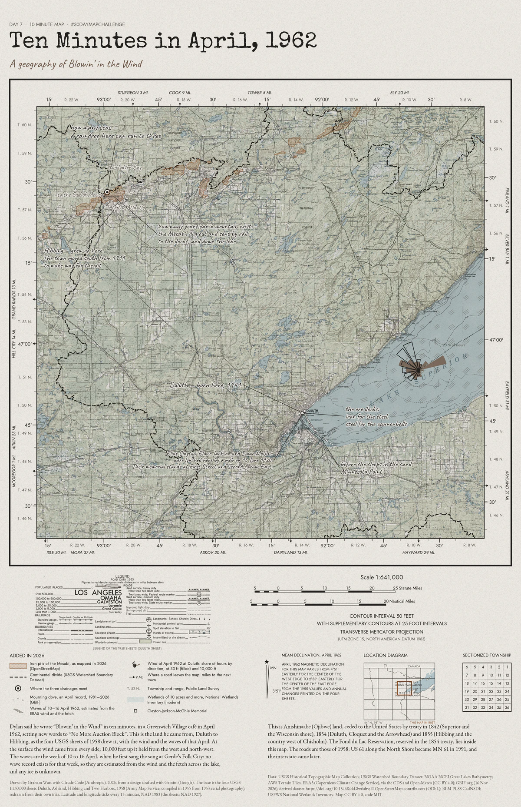
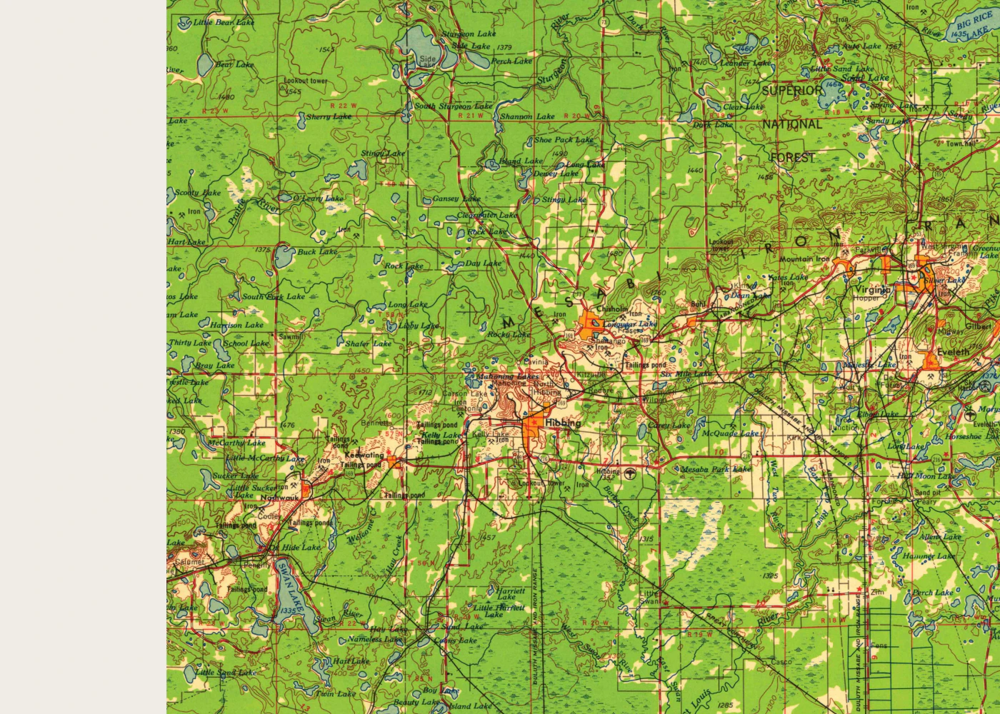
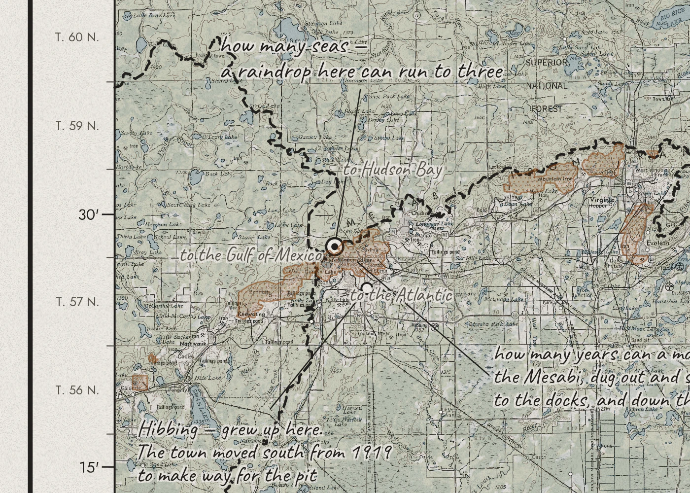
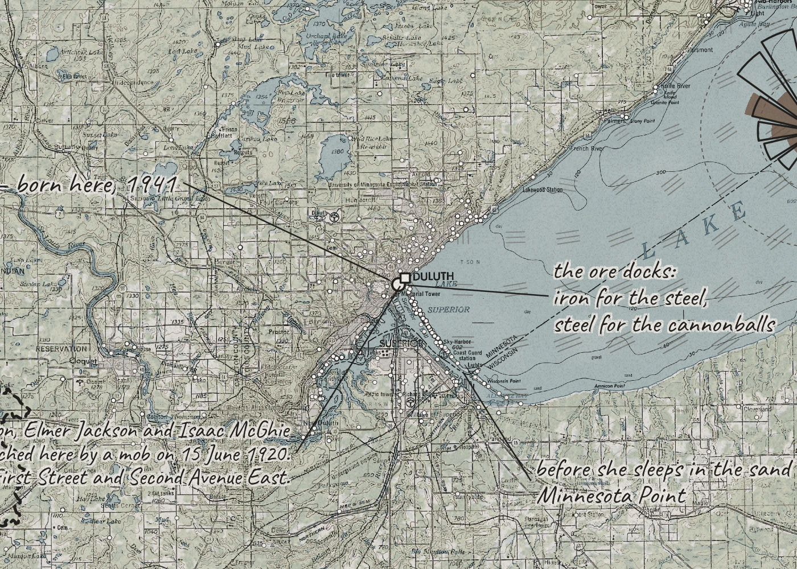

::: {.wrap .day}

<nav class="crumb"><a href="index.html">30 Day Map Challenge 2026</a> <span>/</span> Day 7</nav>

<header>
<p class="kicker">Day 7 · 10 minute map · 7 November 2026</p>
<h1>Ten Minutes in April, 1962</h1>
<p class="sub">A geography of <i>Blowin' in the Wind</i>. Dylan said he wrote the song in ten minutes in April 1962. This is the land he came from, Duluth to Hibbing, as the four USGS sheets of 1958 drew it, with the wind and the waves of that April, set out on the page of a 1958 sheet.</p>

</header>

```{=html}
<link rel="stylesheet" href="css/day07.css?v=20261116b">
<figure class="wide"><div id="d7-viewer" class="d7-deep" role="img" aria-label="The whole sheet: the 1958 map of Duluth to Hibbing in watercolour washes with the song's notes, the collar of latitude, township and road distances, and the lower collar of legend, scales, declination, location diagram and story, zoomable, with a small overview"></div><figcaption>The whole sheet, Tabloid (11 × 17 in), 1:641,000, at the 1958 scans' own resolution. Zoom with the + and − buttons, a double click or a pinch; drag to move. The small sheet in the corner shows where you are. The zoom viewer is not yet made for screen readers; the sections below describe the map in words.</figcaption></figure>
<div class="d7-pair">
<figure><figcaption>The same window on the 1958 sheets, as scanned: where the map began.</figcaption></figure>
<figure><figcaption>Hibbing and the Hill of Three Waters: a raindrop here can run to Hudson Bay, the Gulf of Mexico or the Atlantic.</figcaption></figure>
<figure><figcaption>Duluth, where Dylan was born, the ore docks and Minnesota Point.</figcaption></figure>
</div>
<script defer src="https://cdnjs.cloudflare.com/ajax/libs/openseadragon/5.0.1/openseadragon.min.js" integrity="sha512-gPZzE+sKmE0kvcjMxW431ef5b5T5QOADV9Gij0isPw2oLATd1IZW7dmDmKh7F2e5BfwjQyAfFp3/OF0fVMOF7Q==" crossorigin="anonymous"></script>
<script defer src="js/day07.js?v=20261116a"></script>
```

<details class="d7-fold">
<summary><h2>Reading the map</h2></summary>

<div class="cols">
<div>

**The song's questions, as places.** *How many roads*: the 1958 roads, with the miles to the next town in the collar where each leaves the map, as the sheets printed them. *How many seas*: the three continental drainages, Hudson Bay, the Gulf of Mexico and the Atlantic, meet on the Hill of Three Waters by Hibbing. *How many years can a mountain exist*: the Mesabi iron pits as mapped today, in rust over the 1958 print, where that year's pits show only as tight brown contours. *The white dove, the sand*: mourning dove records of April, and Minnesota Point. *Blowin' in the wind*: the wind of April 1962 at Duluth, at the surface and 10,000 feet up, and the waves of the week he first sang the song.

**The sheet.** The base is the four USGS 1:250,000 sheets of 1958 (Duluth, Ashland, Hibbing and Two Harbors), separated into their inks and printed again in the colours of a 1963 folk record: charcoal, suede, one rust accent. Woods, water and wetlands are gentle watercolour washes in the sheets' own hues. The collar and the lower collar follow the sheets: latitude and longitude every 15 minutes, township and range, statute and nautical miles, the April 1962 magnetic declination worked out from the sheets' own 1955 values, and the sheets' legend in the new inks.

</div>
<div>

**What the numbers say.** At the surface the April 1962 wind came from every side: a mean speed of 4.4 m/s but a mean vector of only 1.1 m/s. At 10,000 feet it held from the west and north-west (12.3 m/s, mean vector 7.6 m/s from 296°). The waves of 10 to 16 April are an estimate from that wind and the fetch across the lake: a mean height of about 0.2 m, at most 0.8 m. Today the frame holds seventeen large Mesabi pits; Hibbing itself moved south from 1919 to make way for one.

**The land.** This is Anishinaabe (Ojibwe) land, ceded to the United States by treaty in 1842 (Superior and the Wisconsin shore), 1854 (Duluth, Cloquet and the Arrowhead) and 1855 (Hibbing and the country west of Chisholm). The Fond du Lac Reservation, reserved in the 1854 treaty, lies inside the map. In Duluth, the Clayton-Jackson-McGhie Memorial stands where Elias Clayton, Elmer Jackson and Isaac McGhie were lynched in June 1920.

</div>
</div>

</details>

<details class="d7-fold">
<summary><h2>Data, method and limits</h2></summary>

<div class="cols">
<div>

**The 1958 sheets.** The USGS scans are cut at their graticule, moved from NAD27 to NAD83 by an explicit datum shift, and mosaicked at 20 m. Each pixel is split into the sheets' inks (black, red, brown, blue line; woodland green, water and urban tints) by colour against that sheet's own paper, so the four printings match. The map raster is built at 762 dpi, one pixel of the scans, so the lettering holds.

**Added layers.** Today's Mesabi pits from OpenStreetMap; the continental divides from the USGS Watershed Boundary Dataset; mourning dove records from GBIF; the April 1962 wind from ERA5; the wave estimate from that wind and the fetch over a lake mask from NOAA's bathymetry; township and range from the BLM's Public Land Survey; wetlands from the National Wetlands Inventory; the road distances along today's roads to the first town beyond the edge.

**Methods.** I chose the theme and the song, and drafted the first design with Gemini (Google). Claude Code (Anthropic; Claude Opus 5.5) reviewed that design and checked its facts, wrote the specification, and built the pipeline in R and Python under my direction. Gemini models reviewed the plan and the code; every finding was checked against the code before it was acted on. I made the design calls, from the 1958 base and its collar to the washes.

</div>
<div>

**Limits.** The wind is a reanalysis: ERA5 in 1962 had no satellite input, so it shows the month's flow, not a day in Greenwich Village. The waves are an estimate, not a record; buoys came later and any ice is unknown. The doves are modern records, mostly after 2000. The pits are today's; the 1958 pits are left as the sheets drew them. The wetland wash is the modern National Wetlands Inventory: it matches the sheets' own marsh symbols roughly, not exactly. The road distances use today's roads, so a 1958 route may differ by a mile or two. The ink separation is a reading of scans: some letters break or land in the wrong ink when you zoom in close.

**Code and data.** The code is in this site's repository under `day-07/`, with a design brief a cartographer could repeat in another stack. Map CC BY 4.0, code MIT.

</div>
</div>

</details>

<details class="formula refs">

<summary>Sources</summary>

<p class="rline small">The 1958 sheets</p>

<ul class="bib">
<li>U.S. Geological Survey (1958). <i>Duluth</i>; <i>Ashland</i>; <i>Hibbing</i>; <i>Two Harbors</i>. 1:250,000 series (topographic), compiled 1955. Scans from the USGS Historical Topographic Map Collection, public domain. <a href="https://ngmdb.usgs.gov/topoview/">https://ngmdb.usgs.gov/topoview/</a></li>
</ul>

<p class="rline small">Data and software</p>

<ul class="bib">
<li>Hersbach, H., et al. (2020). The ERA5 global reanalysis. <i>Quarterly Journal of the Royal Meteorological Society</i>, 146, 1999–2049. <a href="https://doi.org/10.1002/qj.3803">https://doi.org/10.1002/qj.3803</a>. Copernicus Climate Change Service, via the CDS and Open-Meteo, CC BY 4.0. [The wind of April 1962.]{.why}</li>
<li>U.S. Geological Survey. Watershed Boundary Dataset (HUC8). Public domain. <a href="https://www.usgs.gov/national-hydrography/watershed-boundary-dataset">https://www.usgs.gov/national-hydrography/watershed-boundary-dataset</a> [The three seas and their divides.]{.why}</li>
<li>NOAA National Centers for Environmental Information. Bathymetry of Lake Superior. <a href="https://www.ncei.noaa.gov/products/great-lakes-bathymetry">https://www.ncei.noaa.gov/products/great-lakes-bathymetry</a>; AWS Terrain Tiles via elevatr. [Relief and the lake mask for the waves.]{.why}</li>
<li>GBIF.org (16 November 2026). Derived dataset: mourning dove (<i>Zenaida macroura</i>) April records, Duluth to Hibbing, 1981–2026, CC0 and CC BY. <a href="https://doi.org/10.15468/dd.8w6ahv">https://doi.org/10.15468/dd.8w6ahv</a>. The 2,051 records used are in the repository, <code>day-07/data/gbif_doves_used.csv</code>. [The doves.]{.why}</li>
<li>U.S. Fish and Wildlife Service. National Wetlands Inventory. Public domain. <a href="https://www.fws.gov/program/national-wetlands-inventory">https://www.fws.gov/program/national-wetlands-inventory</a> [The wetland wash.]{.why}</li>
<li>Bureau of Land Management. PLSS CadNSDI. Public domain. <a href="https://gis.blm.gov">https://gis.blm.gov</a> [Township and range; the state outlines of the location diagram.]{.why}</li>
<li>OpenStreetMap contributors. ODbL. <a href="https://www.openstreetmap.org/copyright">https://www.openstreetmap.org/copyright</a> [Today's pits and the roads and towns beyond the map.]{.why}</li>
<li>USDA Forest Service. Indian Land Cessions in the United States (Royce, 1899, digitised). <a href="https://data.fs.usda.gov/geodata/edw/datasets.php">https://data.fs.usda.gov/geodata/edw/datasets.php</a> [The treaty check.]{.why}</li>
<li>R Core Team. R; sf, terra, ggplot2 and others. GDAL/OGR contributors. GDAL 3.12. OpenSeadragon 5.0.1. <a href="https://openseadragon.github.io">https://openseadragon.github.io</a> [The pipeline, the map and the zoom viewer.]{.why}</li>
</ul>

</details>

:::
