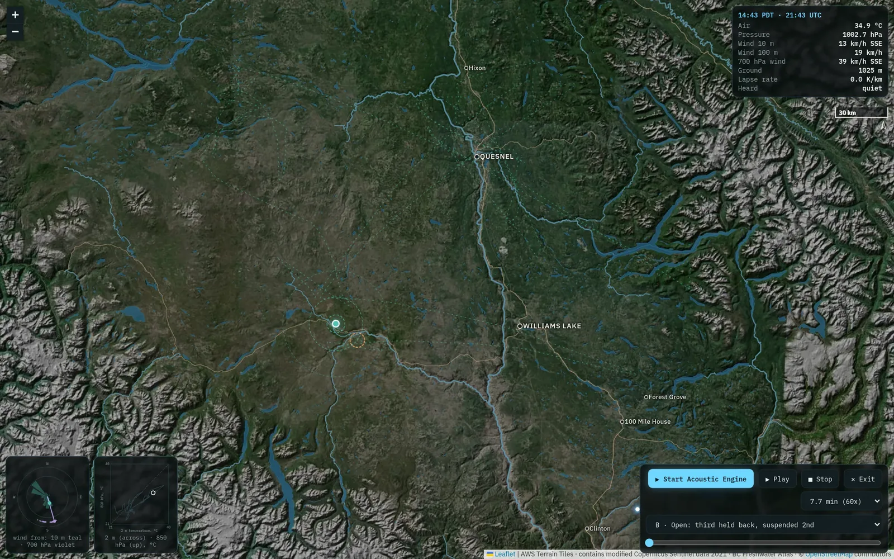

::: {.wrap .day}

<nav class="crumb"><a href="index.html">30 Day Map Challenge 2026</a> <span>/</span> Day 11</nav>

<header>
<p class="kicker">Day 11 · Senses: Sound · 11 November 2026</p>
<h1>2424/461, mapped again</h1>
<p class="sub">2,424 lightning flashes in 461 minutes over the Cariboo and Chilcotin on 30 June 2021, played as thunder, wind and weather from a pin that follows the storm. The sound is as it was. The map under it is new, rebuilt with what the first ten days of this challenge taught.</p>
</header>

```{=html}
<link rel="stylesheet" href="css/day06.css?v=20261110h">
<style>
.d11-frame { width: 100%; height: 2400px; border: 0; display: block; background: #070b0d; }
.d11-pair { display: grid; gap: 10px; }
.d11-pair img { width: 100%; height: auto; display: block; border: 1px solid var(--line); }
.d11-tools { display: flex; flex-wrap: wrap; gap: 8px 12px; margin: 0 0 8px; }
.d11-changes { display: grid; gap: 4px 18px; grid-template-columns: minmax(0, 1fr); }
@media (min-width: 900px) { .d11-changes { grid-template-columns: minmax(0, 1fr) minmax(0, 1fr); } }
</style>
<p class="small">Press <b>Start Acoustic Engine</b>, then <b>Play Storm</b>; headphones help. This is the live piece from <a href="https://cordilleran.github.io/sonify-viz/lightning.html">sonify-viz</a>, framed here, so both sites always show the same version. <a href="https://cordilleran.github.io/sonify-viz/lightning/index.html">Open it on its own page</a> for the full-screen view.</p>
<iframe class="d11-frame" id="d11-piece" src="https://cordilleran.github.io/sonify-viz/lightning/index.html" title="2424/461: interactive map and sound player, 2,424 lightning flashes over 461 minutes" loading="lazy" allow="autoplay; fullscreen"></iframe>
<script>
// The piece posts its own height; only that frame may resize it.
window.addEventListener('message', (e) => {
  const f = document.getElementById('d11-piece');
  if (e.source !== f.contentWindow || e.origin !== 'https://cordilleran.github.io') return;
  if (e.data && typeof e.data.wyrHeight === 'number') f.style.height = (e.data.wyrHeight + 8) + 'px';
});
</script>
```

## Before and after

```{=html}
<div class="d11-tools">
  <div class="seg small" role="group" aria-label="Which version of the map"><button type="button" data-v="before" aria-pressed="false">Before (26 October)</button><button type="button" data-v="after" aria-pressed="true">After (10 November)</button></div>
  <div class="seg small" role="group" aria-label="Which view"><button type="button" data-view="map" aria-pressed="false">On the page</button><button type="button" data-view="imm" aria-pressed="true">Immersive</button></div>
</div>
<figure class="wide"><div class="d11-pair"></div>
<figcaption>The same moment, the start of the storm, with the pin chasing the busiest cluster. Switch between the versions to see what changed.</figcaption></figure>
<script>
(function () {
  const img = document.getElementById('d11-img');
  const alt = { before: 'The map before the update: a dark green hillshade, one town, rivers off', after: 'The map after the update: relief with satellite colour, rivers, lakes, highways and six towns' };
  let v = 'after', view = 'imm';
  function show() { img.src = `img/day11/${v}_${view}.webp`; img.alt = alt[v]; }
  for (const attr of ['data-v', 'data-view']) {
    const bs = document.querySelectorAll(`.d11-tools button[${attr}]`);
    bs.forEach((b) => b.addEventListener('click', () => {
      bs.forEach((o) => o.setAttribute('aria-pressed', String(o === b)));
      if (attr === 'data-v') v = b.dataset.v; else view = b.dataset.view;
      show();
    }));
  }
})();
</script>
```

<details class="d6-fold" open>
<summary><h2>What changed, and which day taught it</h2></summary>

::: {.d11-changes}

**Relief with imagery** (Day 6, the tiled zoom). A hillshade blended with Sentinel-2 true colour from 22 May to 29 June 2021, most of it from the clear, hot days of 25 to 29 June just before the storm: the land the lightning crossed. It is cut into map tiles, so you can now zoom to eight times the starting view (it was two), and it stays sharp to about 100 m.

**Rivers that wait for zoom** (Day 1, stream order; Day 6, layers that keep quiet). The old map drew every stream of order 4 and up at once, which was busy. Now only the main rivers show at the start, and each step of zoom adds the next order down. Lakes are filled and drawn over the streams.

**Towns and highways** (Day 6, labels kept inside the frame). The six most populous towns around the storm, from OpenStreetMap. Each label takes the first side of its dot that stays inside the map and clear of other labels and the readouts, or hides. Highways are thin, warm lines.

**Scale bar and north arrow** (the project rule since Day 2). The map had neither.

**Buttons for the layers** (Day 6, pickers). Relief, rivers and lakes, highways and towns each switch on and off from a row of buttons above the map.

**A steadier pin** (Day 4, the same storm). The map sometimes shook while it followed the pin. The follow now aims only where the map is allowed to go and holds still for small moves. The shake was rare and did not show in testing before or after, so this is a likely fix, not a proven one.

:::

**The sound** is unchanged: the same samples, mappings and harmony as the 26 October version.

</details>

<details class="d6-fold">
<summary><h2>Data, method and limits</h2></summary>

**Data.** Flashes: GOES-17 Geostationary Lightning Mapper (NOAA/NESDIS, open data). Terrain: AWS Terrain Tiles (Mapzen and others; [sources](https://github.com/tilezen/joerd/blob/master/docs/attribution.md)). Imagery: contains modified Copernicus Sentinel data 2021, scenes found through the Element 84 Earth Search catalogue. Rivers and lakes: BC Freshwater Atlas (Open Government Licence - British Columbia). Towns and highways: © OpenStreetMap contributors (ODbL). The weather, sound and sample credits are in the piece's own *About this page*.

**Method.** For each Sentinel-2 grid tile, the clearest scene in the window (48 tiles), read at 80 m and mosaicked; the hillshade (sun from the north-west, relief exaggerated twice) sets the light, the imagery the colour, darkened for the piece's night palette. Rivers are Strahler orders from the Freshwater Atlas. The towns are OpenStreetMap's six largest by their population tags in and around the storm's extent; places without a population tag cannot rank.

**Limits.** The imagery is a mosaic of different days, so colour can step at scene edges. Some communities (108 Mile Ranch, Lac La Hache) have no population tag in OpenStreetMap and so no label. The page says nothing about what started any fire.

**Methods.** I chose the theme, the piece and the changes. Claude Code (Anthropic; Claude Opus 5.5) built them and tested the page in a headless browser at desktop and phone sizes. The page code is on [sonify-viz](https://github.com/cordilleran/sonify-viz/tree/main/lightning); the map builders stay with the project working files.

</details>

:::
