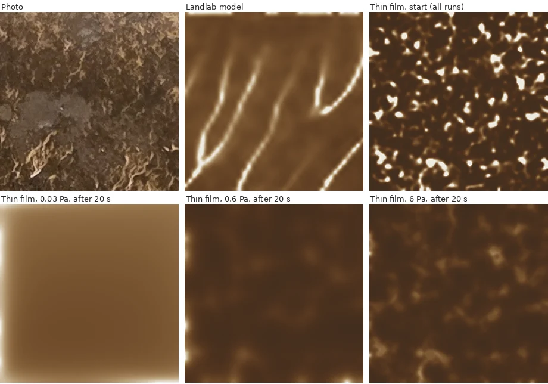

::: {.wrap .day}

<nav class="crumb"><a href="index.html">30 Day Map Challenge 2026</a> <span>/</span> Day 14</nav>

<header>
<p class="kicker">Day 14 · Borgesian map · 14 November 2026</p>
<h1>The Bath, Drained</h1>
<p class="sub">After a muddy run, the dogs had a bath. When the plug was pulled, the water left a map on the floor of the tub: a thin film of silt cut by pale, branching channels, like a reservoir bed after the dam is opened. This is a model of how that map was made, drawn at the scale of the tub and finer.</p>

</header>

```{=html}
<style>
.d14-frame { width: 100%; height: 74vh; min-height: 480px; border: 1px solid var(--line); display: block; background: #ece6da; }
.d14-links { display: flex; flex-wrap: wrap; gap: 6px 16px; margin: 8px 0 0; }
.d14-fold summary { font-size: 14px; }
.d14-epi { font: 400 italic 15px/1.5 var(--serif); color: var(--muted); max-width: 60ch; margin: 18px 0 4px; }
.d14-chart { width: 100%; max-width: 760px; margin: 8px 0 4px; position: relative; }
.d14-chart svg { width: 100%; height: auto; display: block; overflow: visible; }
.d14-chart text { font: 11px var(--mono); fill: var(--muted); }
.d14-chart .lab { fill: var(--ink); }
.d14-tip { position: absolute; pointer-events: none; background: var(--tile); border: 1px solid var(--line); border-radius: 3px; padding: 4px 8px; font: 11px/1.35 var(--mono); color: var(--ink); white-space: nowrap; display: none; z-index: 5; }
.d14-legend { display: flex; gap: 14px; flex-wrap: wrap; font: 11px var(--mono); color: var(--muted); margin: 2px 0 0; }
.d14-legend i { display: inline-block; width: 16px; height: 3px; vertical-align: middle; margin-right: 5px; border-radius: 2px; }
.d14-multi { display: grid; grid-template-columns: repeat(auto-fit, minmax(210px, 1fr)); gap: 12px; max-width: 760px; }
.d14-thumbs { display: grid; grid-template-columns: repeat(auto-fit, minmax(200px, 1fr)); gap: 10px; max-width: 760px; margin: 8px 0; }
.d14-thumbs figure { margin: 0; } .d14-thumbs img { width: 100%; display: block; border: 1px solid var(--line); }
.d14-thumbs figcaption { font: 11px var(--mono); color: var(--muted); margin-top: 3px; }
.d14-table { overflow-x: auto; max-width: 760px; }
.d14-table table { border-collapse: collapse; font: 12px/1.4 var(--mono); width: 100%; }
.d14-table th, .d14-table td { border-bottom: 1px solid var(--line); padding: 5px 8px; text-align: left; vertical-align: top; }
.d14-table td.num, .d14-table th.num { text-align: right; font-variant-numeric: tabular-nums; }
.d14-fig { margin: 10px 0 6px; max-width: 760px; } .d14-fig img { width: 100%; height: auto; display: block; border: 1px solid var(--line); }
.d14-table td.eq { font-family: Georgia, "Times New Roman", serif; font-size: 13px; min-width: 15em; }
.pill { display: inline-block; font: 500 10px/1 var(--mono); letter-spacing: .06em; padding: 3px 6px; border-radius: 9px; border: 1px solid var(--line); white-space: nowrap; }
.pill.yes { border-color: var(--river); color: var(--river); } .pill.part { border-color: var(--amber); color: var(--amber); } .pill.no { color: var(--muted); }
</style>
<p class="d14-epi">"…the Cartographers Guilds struck a Map of the Empire whose size was that of the Empire, and which coincided point for point with it." Jorge Luis Borges, "On Exactitude in Science" (1946)</p>
<iframe class="d14-frame" src="day14_tub.html" title="Zoomable map of the drained bathtub: the simulated mud film in hillshade, with the photograph by swipe" loading="lazy"></iframe>
<p class="d14-links small"><a href="day14_tub.html">Open the map on its own page</a> <a href="#eda">What could make these patterns</a> <a href="#methods">Methods</a></p>
<p class="small">Scroll or pinch to zoom; the number at the bottom right is the size of the map against the tub. Press <b>1 : 1</b> to see it at the size of the tub, and <b>Calibrate</b> once with a bank card so that is true on your screen. Zoom past 1 : 1 and the map is larger than the territory. Swipe to compare the model with the photograph. Slide <b>Drain the bath</b> to put the water back and watch the pool retreat.</p>
```

## What could make these patterns {#eda}

```{=html}
<div id="d14eda">
<h3>Bare enamel along the tub</h3>
<p class="small">Share of the floor scoured pale in each 4 cm slice, from the drain end (left) to the far end. Photo, the chosen model run, and the range of the 16-run sweep.</p>
<div class="d14-chart" id="cAlong"></div>
<h3>Which way the channels point</h3>
<p class="small">Angle between each channel and the direction to the drain, in three zones, weighted by how clearly linear the texture is. 0° means the channel runs straight at the drain. Near the axis the photo's channels point at the drain; on the walls they run every way.</p>
<div class="d14-multi" id="cRose"></div>
<h3>Many answers fit (equifinality)</h3>
<p class="small">Misfit to the photo for each pair of rates in the sweep (lower is better; darker is a better fit). The fit is set almost entirely by the stripping rate: across an eightfold range of the channel-cutting rate the misfit hardly changes, so the photo cannot pin that rate down. The three best runs, below, score within 0.03 of each other and look different.</p>
<div class="d14-chart" id="cHeat"></div>
<div class="d14-thumbs" id="thumbs"></div>
<h3>Is the channel spacing real, or the grid's?</h3>
<p class="small">Fable 5.2 warned that channel spacing in such a model may be set by the grid cell. The same run at three grid sizes, with the film routing smoothed over the same 3 mm in each:</p>
<div class="d14-table" id="tGrid"></div>
<p class="small">A finer grid gives closer channels (31 mm apart at 1 mm, against 40 mm at 2 and 4 mm), so the spacing is partly the grid's. At every grid size the model's channels on the flanks are about three times further apart than the photo's 13 mm: the real film fingered more finely than this model can.</p>
<h3>The drawdown</h3>
<p class="small">Water left in the model's pool after the plug is pulled. Slide <b>Drain the bath</b> on the map to see where the shoreline was.</p>
<div class="d14-chart" id="cDrain"></div>
</div>
```

### Features and the processes that could make them

```{=html}
<div class="d14-table">
<table>
<thead><tr><th>Feature in the photo</th><th>Likely process</th><th>In the model</th><th>Equation or rule</th></tr></thead>
<tbody>
<tr><td>Broad pale swath from the drain to mid-tub</td><td>The last of the pool rushing along the lowest line to the drain; strong shear in shallow fast water</td><td><span class="pill part">partly</span>: the shallow-water step makes the swath, but scours the whole drain end bare, where the photo keeps mud</td><td class="eq"><i>τ</i> = <i>ρ g n</i><sup>2</sup><i>u</i><sup>2</sup> / <i>h</i><sup>1/3</sup>; <i>E</i> = <i>K</i>(<i>τ</i> − <i>τ</i><sub>c</sub>)</td></tr>
<tr><td>Feathered channels either side of the axis</td><td>The film draining off the flanks to the retreating shoreline</td><td><span class="pill part">partly</span>: oblique channels form, but straighter and more even than the photo's</td><td class="eq"><i>E</i> = <i>K</i><sub>r</sub> max(<i>qS</i> − <i>θ</i>, 0), <i>q</i> routed (D-infinity) to the shoreline</td></tr>
<tr><td>Short channels from the walls</td><td>Film and rivulets running off the curved walls</td><td><span class="pill part">partly</span>: too regular; real rivulets meander</td><td class="eq"><i>E</i> = <i>K</i><sub>r</sub> max(<i>qS</i> − <i>θ</i>, 0), <i>q</i> routed (D-infinity) to the shoreline</td></tr>
<tr><td>Pale halo round the drain</td><td>Flow converging on the drain; speed rises toward it</td><td><span class="pill part">partly</span>: lost inside the over-wide bare patch at the drain end</td><td class="eq"><i>τ</i> = <i>ρ g n</i><sup>2</sup><i>u</i><sup>2</sup> / <i>h</i><sup>1/3</sup>; <i>E</i> = <i>K</i>(<i>τ</i> − <i>τ</i><sub>c</sub>), <i>u</i> rising toward the sink</td></tr>
<tr><td>Spotted, pale far end</td><td>Thin film on the sloping backrest</td><td><span class="pill part">partly</span>: the model's far end is thinner still, almost bare</td><td class="eq">where <i>H</i> &lt; 0.6<i>H</i><sub>0</sub> and <i>S</i> &gt; 0.04: <i>H</i> × 1.6 on blobs, × 0.25 between</td></tr>
<tr><td>Dark angular blotches on the lower walls</td><td>Film beading up as it thins (dewetting), slumping, the dogs' feet</td><td><span class="pill part">by rule</span></td><td class="eq">where <i>H</i> &lt; 0.6<i>H</i><sub>0</sub> and <i>S</i> &gt; 0.04: <i>H</i> × 1.6 on blobs, × 0.25 between</td></tr>
<tr><td>Tide lines round the drain-end wall</td><td>Residue left where the level paused or sloshed</td><td><span class="pill part">by rule</span></td><td class="eq"><i>H</i> += 0.25<i>H</i><sub>0</sub> exp(−((<i>z</i> − <i>z</i><sub>k</sub>) / 0.6 mm)<sup>2</sup>), five levels <i>z</i><sub>k</sub> from 22 to 50 mm</td></tr>
<tr><td>Crenulated, sinuous channel edges</td><td>Surface tension and the mud's stickiness; fingering of a thin film</td><td><span class="pill no">not modelled</span>: no surface tension in Landlab's flow</td><td class="eq">none. It would need the thin-film equation, ∂<i>h</i>/∂<i>t</i> = −∇·[(<i>h</i><sup>3</sup>/3<i>μ</i>) ∇(<i>γ</i>∇<sup>2</sup><i>h</i>)]</td></tr>
</tbody></table>
</div>
<p class="small">Symbols: <i>τ</i> bed shear stress, <i>ρ</i> water density, <i>g</i> gravity, <i>n</i> Manning roughness, <i>u</i> speed, <i>h</i> water depth, <i>E</i> stripping rate, <i>K</i> and <i>K</i><sub>r</sub> rates, <i>τ</i><sub>c</sub> threshold shear, <i>q</i> film discharge per unit width, <i>S</i> slope, <i>θ</i> threshold, <i>H</i> mud thickness, <i>H</i><sub>0</sub> mean settled mud, <i>z</i> height on the wall, <i>μ</i> viscosity, <i>γ</i> surface tension.</p>
<h3 id="thinfilm">A second model: the mud as a thin film</h3>
<p class="small">At 1 : 1 the photo shows flat dark slabs with a lace of pale threads between them, 1 to 5 mm long. Landlab's channels are tens of millimetres apart and cannot make that. So a patch of the upper flank (80 by 80 mm, 0.5 mm grid) was run again as a thin film of wet mud with a yield stress: it flows only where the stress on it passes a threshold, under gravity and surface tension, starting from the Landlab mud made lumpy at the millimetre scale.</p>
<figure class="d14-fig"></figure>
<p class="small">It did not make the lace. Under a continuous water surface, surface tension flattens millimetre lumps faster than the mud drains: a lump 0.4 mm high and 1 mm across puts about 12 Pa of shear on its base, more than the yield stresses tried. Weak mud drains to an even sheet; stiff mud barely moves and the lumps fade. So the lace in the photo needs something this model leaves out: mud stiff enough to stay put while the water drains over it as a separate layer, or a water surface that broke into pieces, with edges (contact lines) that set where the threads formed. A grid fine enough for those edges is about twenty times finer than this one.</p>
<div class="d14-table"><table>
<thead><tr><th>Upper flank patch</th><th class="num">Edge length, mm per mm²</th><th class="num">Patches minus holes, per cm²</th><th class="num">Correlation length, mm</th></tr></thead>
<tbody>
<tr><td>Photo</td><td class="num">0.45</td><td class="num">3.0</td><td class="num">1.0</td></tr>
<tr><td>Landlab model</td><td class="num">0.12</td><td class="num">0.17</td><td class="num">3.5</td></tr>
<tr><td>Thin film, 0.03 Pa</td><td class="num">0.03</td><td class="num">0.02</td><td class="num">10</td></tr>
<tr><td>Thin film, 0.6 Pa</td><td class="num">0.08</td><td class="num">0.25</td><td class="num">4.5</td></tr>
<tr><td>Thin film, 6 Pa</td><td class="num">0.15</td><td class="num">0.58</td><td class="num">3.0</td></tr>
</tbody></table></div>
<p class="small">Measured on the palest quarter of each image at 0.5 mm a pixel (the photo flattened for lighting first). More edge and more separate pale patches mean a finer lace. The photo has about three times the edge of any model.</p>
<script src="js/day14eda.js"></script>
<script>(function(){function o(){var t=location.hash&&document.getElementById(location.hash.slice(1));if(t&&t.tagName==="DETAILS"){t.open=true;t.scrollIntoView();}}window.addEventListener("hashchange",o);o();})();</script>
```

<details class="formula d14-fold"><summary>What the map shows</summary>

- **The territory.** The floor and lower walls of an enamelled cast-iron tub, 128 by 52 cm of it (the wetted part; the rim is 136 by 61 cm), photographed from above after it drained on 18 March 2026.
- **The map.** A simulated film of mud, drawn as relief in sepia: dark where the mud is thick (about 0.5 mm), pale where the draining water scoured it down to the white enamel. The relief is exaggerated 150 times; the real film is thinner than a fingernail. **Look** in the panel switches to a grey hillshade with the mud tinted, or to wet mud: thickness as tone over the enamel (blue fades first, so thin mud goes cream, then tan, then umber) with the relief kept low. The dashed ring marks the drain.
- **The pale channels.** In the model they grow from the walls toward the middle and the drain end as the shoreline retreats, the way channels cut into a drained reservoir bed. The broad pale swath from the drain is where the last of the pool rushed out.
- **The photograph.** The same floor, rectified to the map frame. The model matches it in its statistics (how much is bare, where, and which way the channels point). It does not reproduce individual channels.

</details>

<details class="formula d14-fold" id="methods"><summary>Methods</summary>

1. **Settling.** The mud settles from the bath: thicker where the water was deeper, in broad lobes about 2.5 cm across, with millimetre lumps.
2. **The plug is pulled.** Landlab's `OverlandFlow` component (the de Almeida shallow-water scheme) drains a pool 12 mm deep at the drain over a floor that falls 0.8 % toward it. Where the shear of the moving water passes a threshold, mud is stripped; the enamel itself does not erode. This makes the swath and the halo at the drain.
3. **The film drains.** Each patch of floor, once uncovered, keeps a film of water about 0.3 mm thick that drains over a few seconds. Landlab's `FlowAccumulator` (D-infinity) routes it to the retreating shoreline, and where the film's stream power passes a threshold it cuts a channel. As the shoreline moves, the channels grow toward it, like a drained reservoir.
4. **Two rules.** Thin film on the sloping walls beads up into blobs (dewetting), and five faint tide lines are left where the level lingered on the walls. Both are set by rule; the map can hatch where they act.
5. **Finer than the model.** The model's grid is 2 mm. The map goes to 0.25 mm: the model is smoothly enlarged, and texture below 2 mm is synthesised from a random field shaped like the photo's grain, then rescaled so each 2 mm square averages back to the model (within 1.3 µm on average, against a film about 270 µm thick). The drawing is softened by 0.5 mm so the model's 2 mm cells don't show as steps. The map says when you have zoomed past the model, and past the photo.
6. **Reverse-engineering.** A sweep over two rates (the stripping rate and the channel-cutting rate) scored each run against the photo: the share of bare enamel, how it varies along and across the tub, and which way the channels point in three zones. Several runs score about the same and look different (above). With one photograph, the model can claim only to be consistent with it.
7. **A thin-film model of one patch.** The upper flank was rerun as a film of wet mud with a yield stress (Bingham lubrication flux, gravity and surface tension, a cosine-transform scheme with implicit stabilising terms; `day-14/thinfilm.py`). The contact line between film and bare enamel could not be resolved at 0.5 mm, so the film is fully wetting. Results and measures are above.

Model, map and page built by Claude Code (Opus 5.5) as orchestrator, from GW's photo and brief, with design consults from Gemini 4 Argon and Fable 5.2. Python 3.13, Landlab 2.11, NumPy, SciPy, Pillow; Leaflet 1.9.4.

</details>

<details class="formula d14-fold"><summary>Limitations</summary>

- **The thickness is assumed.** The mud's thickness was never measured; 0.4 mm is a guess that makes the photo's tones plausible. The photo's darkness carries lamp glare and shadow as well as depth.
- **Some physics is missing.** Landlab's tools were built for landscapes. At this scale, surface tension and the stickiness of the mud matter as much as the flow, and the model has neither. Some channels look right for the wrong reasons; the table above says which.
- **The fine pattern is missing.** At 1 : 1 the photo shows a lace of pale threads, 1 to 5 mm long, between flat dark slabs of mud. The model has smooth channels tens of millimetres apart. A thin-film model with a yield stress, tried on one patch, did not make it either (above); the next model would need two layers (stiff mud, draining water) and contact lines resolved at about 25 µm.
- **Many settings fit.** Different settings make similar maps; the sweep shows the ridge of near-equal fits.
- **The photo frame is approximate.** The photo was squared to the map by its outline; its slight tilt (about 6 % taller at the drain end) and the curve of the walls are not corrected.

</details>

<details class="formula d14-fold"><summary>Data, code and licence</summary>

- **Photo:** GW's own, 18 March 2026, location data removed. **Model, map and text:** CC BY 4.0. **Code:** MIT. The code and the photo are in `day-14/` of this site's repository (`sim.py`, `scripts/`, `data/source/`), so the whole chain can be rerun; `scripts/run_set.sh` remakes the model runs.
- **Software:** Landlab 2.11 (`OverlandFlow`, `FlowAccumulator` with `FlowDirectorDINF`), NumPy, SciPy, Pillow; the map uses Leaflet 1.9.4.
- **Design advice:** Gemini 4 Argon (via agy) and Fable 5.2 reviewed the plan before the build; their suggestions shaped the two-phase model, the grid test, the swipe, the 1 : 1 calibration and the "added by rule" hatching.

</details>

<details class="formula d14-fold"><summary>References</summary>

- Borges, J. L. (1946). Del rigor en la ciencia. *Los Anales de Buenos Aires*, 1(3). English: "On Exactitude in Science", in *Collected Fictions*, trans. A. Hurley (1998), Viking.
- de Almeida, G. A. M., Bates, P., Freer, J. E. and Souvignet, M. (2012). Improving the stability of a simple formulation of the shallow water equations for 2-D flood modeling. *Water Resources Research*, 48, W05528.
- Hobley, D. E. J., et al. (2017). Creative computing with Landlab: an open-source toolkit for building, coupling, and exploring two-dimensional numerical models of Earth-surface dynamics. *Earth Surface Dynamics*, 5, 21–46.
- Tarboton, D. G. (1997). A new method for the determination of flow directions and upslope areas in grid digital elevation models. *Water Resources Research*, 33(2), 309–319.

</details>

:::
