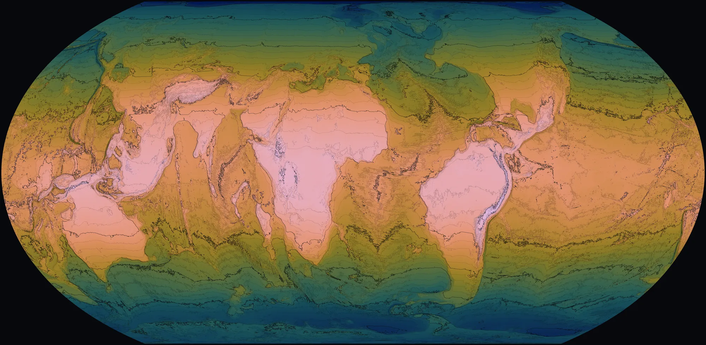
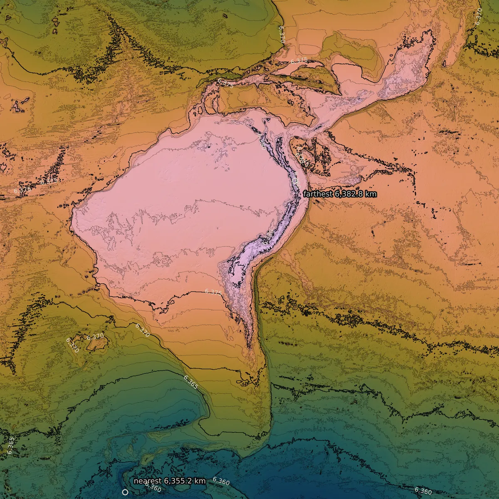
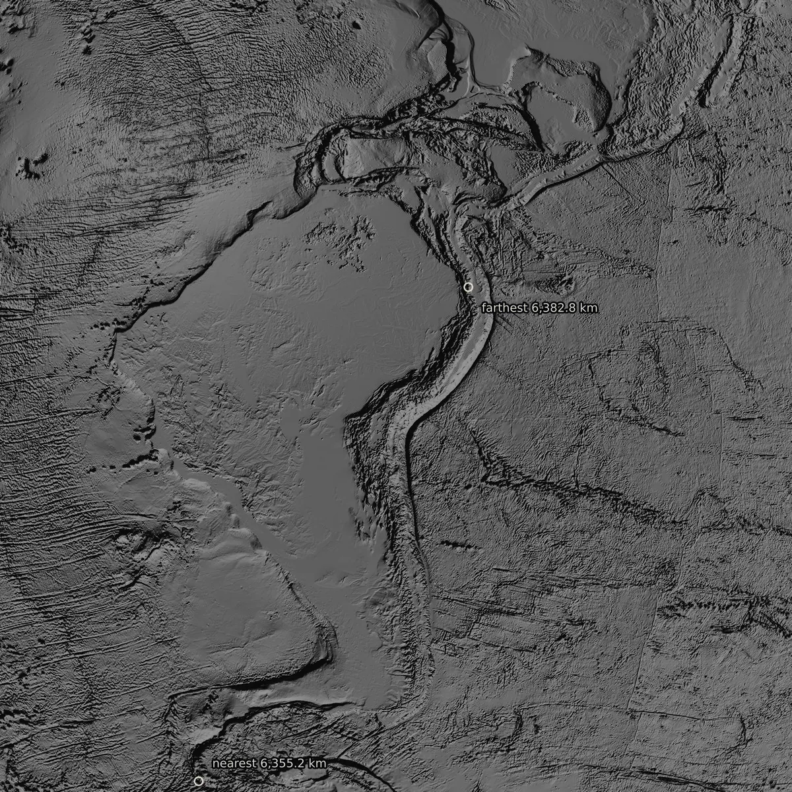
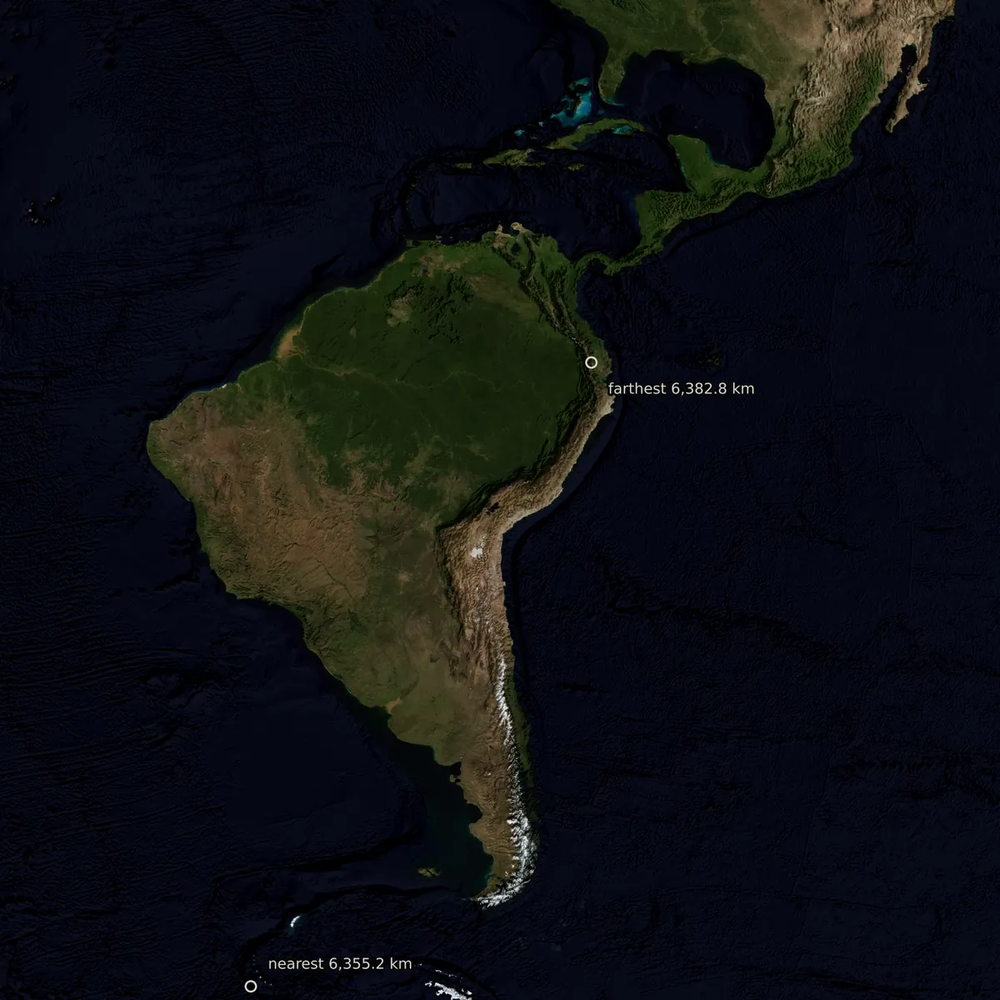
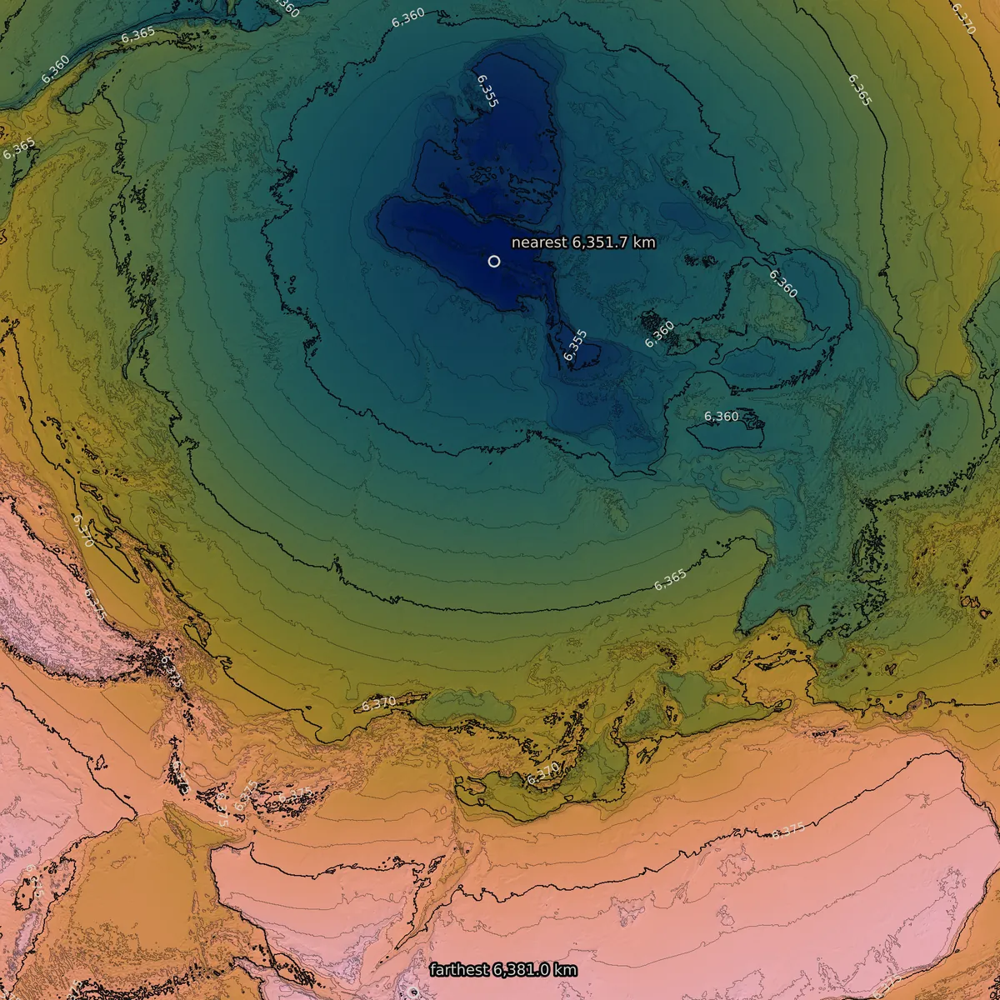
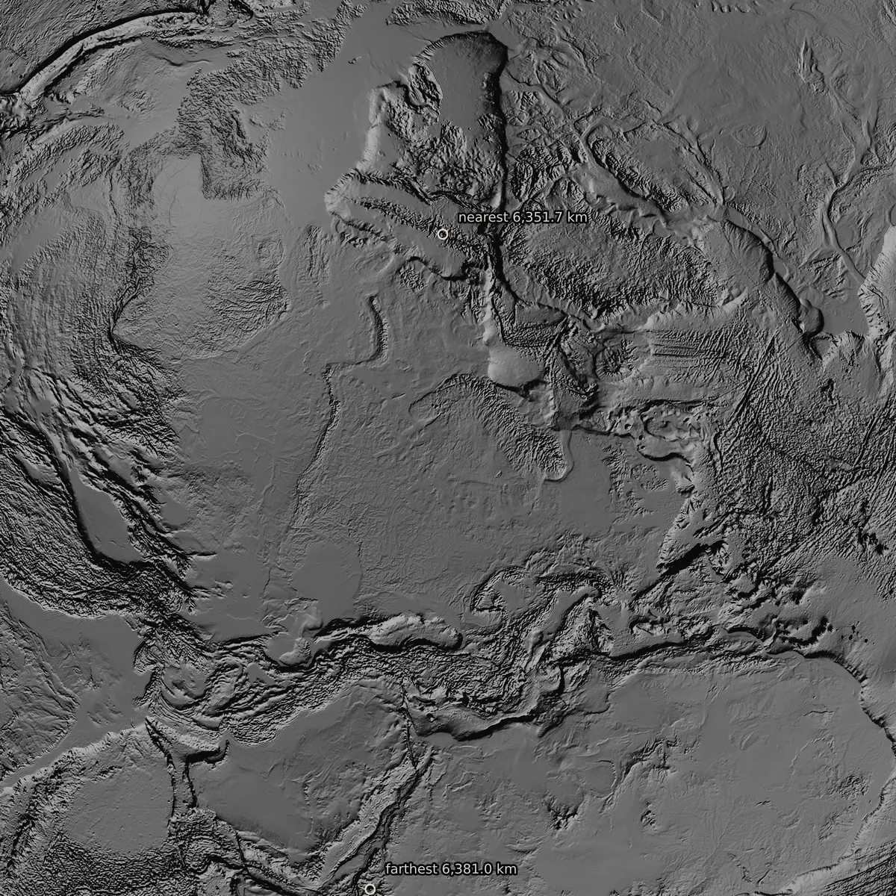
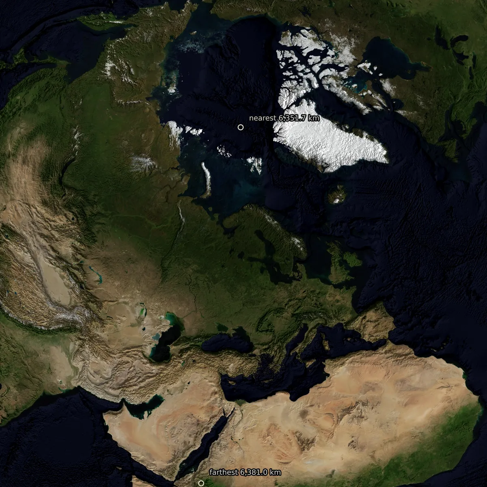

::: {.wrap .day}

<nav class="crumb"><a href="index.html">30 Day Map Challenge 2026</a> <span>/</span> Day 15</nav>

<header>
<p class="kicker">Day 15 · Inside out · 15 November 2026</p>
<h1>The Underside of the World</h1>
<p class="sub">Stand at the centre of the Earth and look up. Colour is how far away the ground is.</p>

</header>

```{=html}
<style>
.d15-tools { display: flex; flex-wrap: wrap; gap: 6px; margin: 0 0 8px; }
.d15-tools button { font: inherit; font-size: 14px; padding: 4px 12px; border: 1px solid var(--line); background: transparent; color: inherit; cursor: pointer; }
.d15-tools button[aria-pressed="true"] { background: var(--ink, #222); color: var(--paper, #fff); }
.d15-viewer { width: 100%; aspect-ratio: 2000 / 977; max-height: 80vh; min-height: 220px; background: #07080c; border: 1px solid var(--line); position: relative; }
.d15-viewer { overflow: hidden; }
.d15-viewer > img { position: absolute; inset: 0; width: 100%; height: 100%; object-fit: contain; display: block; pointer-events: none; }
.d15-key { display: flex; align-items: center; gap: 8px; margin: 8px 0 0; font-size: 13px; }
.d15-key .bar { flex: 0 1 320px; height: 10px; border: 1px solid var(--line); }
.d15-trio { display: grid; grid-template-columns: repeat(3, 1fr); gap: 6px; margin: 10px 0 4px; }
.d15-trio img { width: 100%; height: auto; display: block; }
.d15-trio figure { margin: 0; }
@media (max-width: 640px) { .d15-trio { grid-template-columns: 1fr; } }
</style>
<div class="d15-tools" role="group" aria-label="Which view">
  <button type="button" data-view="hypso" aria-pressed="true">Distance</button>
  <button type="button" data-view="hillshade" aria-pressed="false">Relief</button>
  <button type="button" data-view="fused" aria-pressed="false">Colour</button>
</div>
<div class="d15-viewer" id="d15-viewer" role="region" aria-label="Zoomable world map" data-still="img/day15/world_hypso.webp" data-still-alt="The whole surface of the Earth seen from its centre, coloured by distance from it: the poles nearest in blue, the equator farthest in pink.">
  
</div>
<p class="d15-key" data-view="hypso"><span><span data-k="lo">–</span> km</span><span class="bar" id="d15-legend"></span><span><span data-k="hi">–</span> km from the centre</span></p>
<p class="d15-key small" data-view="hillshade" hidden>Lit from inside, from the upper left. Mountains are hollows; trenches are ridges.</p>
<p class="d15-key small" data-view="fused" hidden>NASA's Blue Marble, under the same light from inside.</p>
<ul class="small">
<li>East is on the left: from inside, the map is a mirror.</li>
<li>Equal area, as seen from the centre: every patch of map is the same patch of sky.</li>
<li>Thin lines every 1 km of distance, bold every 5 km.</li>
<li>The biggest landform is the bulge: the poles are <span data-k="flat">–</span> km closer than the equator.</li>
<li>Farthest ground: <span data-k="rmax">–</span> km, at <span data-k="rmax-at">–</span>, in the Andes, not the Himalaya.</li>
<li>Nearest ground: <span data-k="rmin">–</span> km, at <span data-k="rmin-at">–</span>, the Arctic Ocean floor.</li>
</ul>

<h2>Close up</h2>
<p class="small">Lambert equal-area on each place. A lamp hangs inside the Earth, upper left, and rakes across the underside of the ground.</p>
<h3 class="small">The Andes</h3>
<div class="d15-trio">
<figure><a href="img/day15/andes_hypso.webp"></a><figcaption class="small">Distance</figcaption></figure>
<figure><a href="img/day15/andes_hillshade.webp"></a><figcaption class="small">Relief</figcaption></figure>
<figure><a href="img/day15/andes_fused.webp"></a><figcaption class="small">Colour</figcaption></figure>
</div>
<h3 class="small">Finland and Russia</h3>
<div class="d15-trio">
<figure><a href="img/day15/fennoscandia_hypso.webp"></a><figcaption class="small">Distance</figcaption></figure>
<figure><a href="img/day15/fennoscandia_hillshade.webp"></a><figcaption class="small">Relief</figcaption></figure>
<figure><a href="img/day15/fennoscandia_fused.webp"></a><figcaption class="small">Colour</figcaption></figure>
</div>
```

```{=html}
<details class="formula" id="methods"><summary>Methods</summary>
<ul class="small">
<li>Distance from the centre = WGS84 ellipsoid + geoid (EGM2008) + bedrock height (Earth2014, rock and sea floor under ice and water).</li>
<li>Bedrock from Earth2014's spherical harmonics to degree 2,160 (about 9 km), rolled off above 1,950.</li>
<li>Directions are geocentric: the view from the centre.</li>
<li>Shading: surface normals point to the centre; relief ×<span data-k="z">–</span> for shading only; shadows cast where the ground bulges in between a point and the light.</li>
<li>World: Equal Earth, mirrored. Close-ups: Lambert azimuthal equal-area, mirrored.</li>
</ul>
</details>
<details class="formula"><summary>Limitations</summary>
<ul class="small">
<li>Smoothed to about 9 km: true summits and deeps lie a little farther and nearer than shown.</li>
<li>Blue Marble is a 2004 cloud-free composite at about 7 km.</li>
</ul>
</details>
<details class="formula"><summary>Data, code and licence</summary>
<p class="small">Earth2014 (Hirt and Rexer 2015, Curtin University; cited as its authors ask). EGM2008 (Pavlis et al. 2012), via pyshtools. Blue Marble Next Generation, NASA Earth Observatory (Stöckli et al. 2005). Code, and how to rerun it: <a href="https://github.com/cordilleran/MapChallenge2026/blob/main/day-15/README.md">the Day 15 README</a>.</p>
<p class="small">I chose the theme, the idea (distance from the centre, seen from inside), the three looks and the places. Claude Code (Anthropic; Claude Opus 5.5) built the renders and the page. Python 3.12 (pyshtools, NumPy, Matplotlib, cmcrameri); OpenSeadragon 5.0.1.</p>
</details>
<details class="formula"><summary>References</summary>
<p class="small">Hirt, C., and Rexer, M. (2015). Earth2014: 1 arc-min shape, topography, bedrock and ice-sheet models. <i>International Journal of Applied Earth Observation and Geoinformation</i> 39, 103–112. <a href="https://doi.org/10.1016/j.jag.2015.03.001">doi:10.1016/j.jag.2015.03.001</a><br>Pavlis, N. K., Holmes, S. A., Kenyon, S. C., and Factor, J. K. (2012). The development and evaluation of the Earth Gravitational Model 2008 (EGM2008). <i>Journal of Geophysical Research</i> 117, B04406. <a href="https://doi.org/10.1029/2011JB008916">doi:10.1029/2011JB008916</a><br>Stöckli, R., Vermote, E., Saleous, N., Simmon, R., and Herring, D. (2005). The Blue Marble Next Generation. NASA Earth Observatory.<br>Šavrič, B., Patterson, T., and Jenny, B. (2019). The Equal Earth map projection. <i>International Journal of Geographical Information Science</i> 33, 454–465. <a href="https://doi.org/10.1080/13658816.2018.1504949">doi:10.1080/13658816.2018.1504949</a><br>Wieczorek, M. A., and Meschede, M. (2018). SHTools: Tools for working with spherical harmonics. <i>Geochemistry, Geophysics, Geosystems</i> 19, 2574–2592. <a href="https://doi.org/10.1029/2018GC007529">doi:10.1029/2018GC007529</a><br>Crameri, F. (2018). Scientific colour maps. Zenodo. <a href="https://doi.org/10.5281/zenodo.1243862">doi:10.5281/zenodo.1243862</a></p>
</details>
<script defer src="https://cdnjs.cloudflare.com/ajax/libs/openseadragon/5.0.1/openseadragon.min.js" integrity="sha512-gPZzE+sKmE0kvcjMxW431ef5b5T5QOADV9Gij0isPw2oLATd1IZW7dmDmKh7F2e5BfwjQyAfFp3/OF0fVMOF7Q==" crossorigin="anonymous"></script>
<script defer src="js/day15.js?v=20261119b"></script>
```

:::
