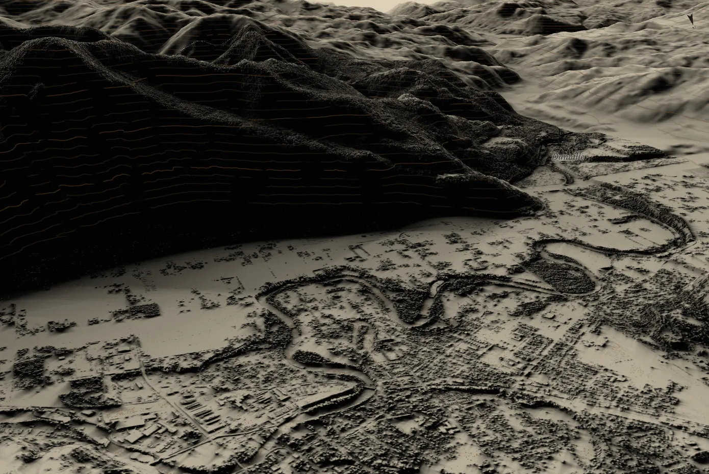
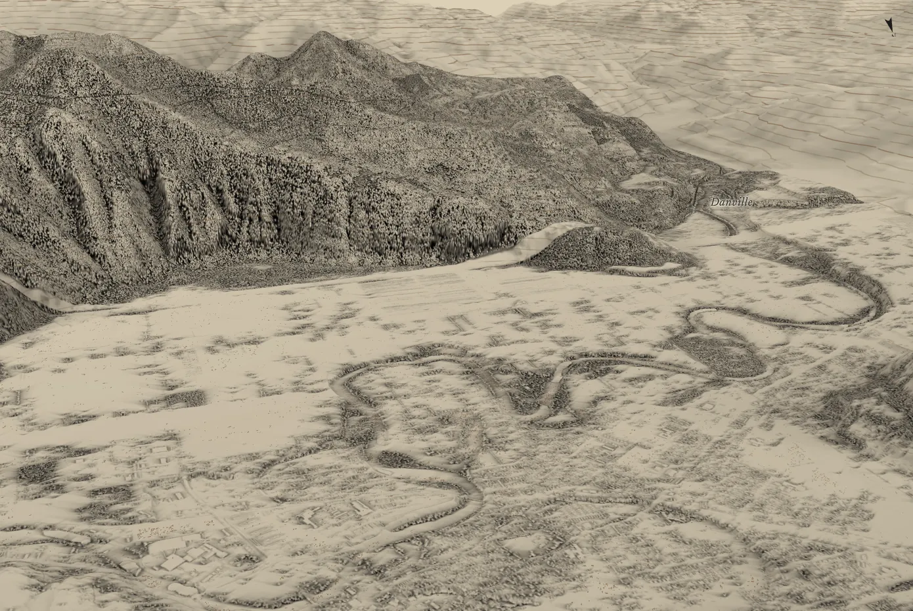

::: {.wrap .day}

<nav class="crumb"><a href="index.html">30 Day Map Challenge 2026</a> <span>/</span> Day 17</nav>

<header>
<p class="kicker">Day 17 · Light and dark · 17 November 2026</p>
<h1>Mountain's Shadow</h1>
<p class="sub">How much of the daylight year each place in the Grand Forks valley spends in shadow, cast by hills, trees and buildings, from airborne LiDAR. White gets the sun whenever it is up; black almost never does.</p>

</header>

```{=html}
<style>
.d17-frame { width: 100%; height: 76vh; min-height: 480px; border: 1px solid var(--line); display: block; background: #efe9dc; }
.d17-links { display: flex; flex-wrap: wrap; gap: 6px 16px; margin: 8px 0 0; }
.d17-fold summary { font-size: 14px; }
.d17-pair { display: grid; grid-template-columns: 1fr 1fr; gap: 8px; margin: 14px 0 6px; }
.d17-pair figure { margin: 0; }
.d17-pair img { width: 100%; height: auto; display: block; border: 1px solid var(--line); }
@media (max-width: 640px) { .d17-pair { grid-template-columns: 1fr; } }
</style>
<iframe class="d17-frame" src="day17_shade.html" title="3D map of the Grand Forks valley, toned by the share of daylight hours in shadow" loading="lazy"></iframe>
<p class="d17-links small"><a href="day17_shade.html">Open the map on its own page</a> <a href="day17_shade.html?view=valley&amp;when=dec">December, from the north</a> <a href="day17_shade.html?view=top&amp;src=objects">What trees and buildings add</a> <a href="#methods">Methods</a></p>
<p class="small">Drag to orbit, right-drag or two fingers to pan, scroll or pinch to zoom. Point at the ground for its numbers. "One date" and "Play the year" move through the year a day at a time.</p>
<div class="d17-pair">
<figure><figcaption class="small">21 December</figcaption></figure>
<figure><figcaption class="small">21 June</figcaption></figure>
</div>
```

```{=html}
<details class="formula d17-fold" id="methods"><summary>Methods</summary>
<ol class="small">
<li><b>Surfaces.</b> The 2025 BC LiDAR surface model (DSM: the top of trees and buildings) and bare-earth model (DEM), averaged from 1 m to 2 m, joined south of the border by USGS 3DEP LiDAR flown in July and August 2022 (DSM from the highest return in each 2 m cell, DEM from the 1 m 3DEP product). Beyond the LiDAR, out to about 25 km in BC and Washington, Google's GEM-15 terrain at 15 m. Vertical datums are tied through GEM-15 on gentle ground.</li>
<li><b>Horizons.</b> For every 1° of azimuth the sun reaches, the horizon angle at every cell, found with a convex-hull sweep along parallel lines (one pass per azimuth). The far field comes from the 15 m terrain and is carried to each 2 m cell through its tangent point.</li>
<li><b>Sun.</b> NREL's solar position algorithm (pvlib) every 5 minutes through 2026, refraction included, counted only while the sun is above the horizon.</li>
<li><b>Count.</b> A place is in shadow when the sun's elevation is below its horizon in that direction. Shade share is the shaded minutes over the minutes with the sun up: for the year, for December and June, and for 27 weekly steps (a week in February and one in late October share a sun path, so 27 steps cover all 365 days). The 27 weeks are stored as their mean and six principal components over the year; the page rebuilds any date from them, blending between weeks by the sun's declination.</li>
<li><b>Drawing.</b> The surface is unlit: its grey tone is the measured share and nothing else.</li>
</ol>
</details>
<details class="formula d17-fold"><summary>Checks</summary>
<ul class="small">
<li>Sun: noon elevation on 21 December 17.58° (expected about 17.5°).</li>
<li>Horizons against a brute-force ray march (300 cells, 8 azimuths): median difference 0.32°. Among trees, tangents within 10 m are less exact; the effect on the annual share is a median of 1.4 percentage points, slightly dark.</li>
<li>The 27 weekly layers, weighted by their daylight, rebuild the annual layer to within 0.11 percentage points.</li>
<li>Image compression changes a value by at most about 3 percentage points (95th percentile); rebuilding a week from six components, by at most 2.5.</li>
</ul>
</details>
<details class="formula d17-fold"><summary>Limitations</summary>
<ul class="small">
<li>Geometry only: no cloud, no valley fog, no diffuse skylight. In winter, inversion fog is the real dark here, and this map does not show it.</li>
<li>Trees are solid. The LiDAR flights were in summer, so deciduous trees cast full shade in winter too; real winter shade under cottonwoods and orchards is less.</li>
<li>The BC (2025) and US (2022) flights are three years apart, and LiDAR tiles were processed separately, so some tile edges show.</li>
<li>Neither survey covers a strip 100 to 200 m wide just south of the border. There, as in other gaps, GEM-15 at 15 m stands in: its surface model gives forest as a smoothed canopy, with no single trees or buildings.</li>
<li>Outside the LiDAR, GEM-15's surface stands in for trees at 15 m; small features are absent.</li>
<li>Earth curvature and refraction are ignored in the horizons (under 0.1° at 25 km).</li>
</ul>
</details>
<details class="formula d17-fold"><summary>Data, code and licence</summary>
<p class="small">LiDAR: Province of British Columbia, 2025 (Open Government Licence – British Columbia); USGS 3D Elevation Program, WA NorthEast 2022 (public domain). Terrain beyond the LiDAR: GEM-15, "This dataset is produced by Google" (CC BY 4.0). Place names: GeoNames (CC BY 4.0), summits checked against the terrain. Code in repository at <a href="https://github.com/cordilleran/MapChallenge2026">.</p>
<p class="small">I chose the theme, the place and the changes (the title, the plain grey look, a date slider). Claude Code (Anthropic; Claude Opus 5.5) built the surfaces, the shade model and the page, and tested it in a headless browser. Python 3.13 (numba, pvlib, rasterio); three.js 0.186.1. </p>
</details>
<details class="formula d17-fold"><summary>References</summary>
<p class="small">Anderson, K. S., Hansen, C. W., Holmgren, W. F., et al. (2023). pvlib python: 2023 project update. <i>Journal of Open Source Software</i> 8, 5994. <a href="https://doi.org/10.21105/joss.05994">doi:10.21105/joss.05994</a><br>Reda, I., and Andreas, A. (2004). Solar position algorithm for solar radiation applications. <i>Solar Energy</i> 76, 577–589. <a href="https://doi.org/10.1016/j.solener.2003.12.003">doi:10.1016/j.solener.2003.12.003</a><br>Batchu, V., Neumann, M., Li, T., et al. (2026). GEM-15: Global surface and terrain elevation models (15 meters) from sub-meter optical stereo imagery. EarthArXiv preprint. <a href="https://doi.org/10.31223/X55N75">doi:10.31223/X55N75</a></p>
</details>
```

:::
